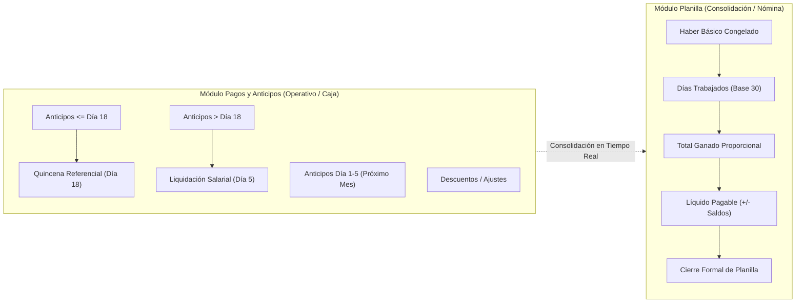

# Especificación de Requisitos de Software (SRS) — Ciclo Salarial: Planilla, Pagos, Anticipos y Liquidación

---

## 1. Contexto, Objetivo y Arquitectura Modular

El sistema **SISTEMAS RAÍCES** gestiona el ciclo salarial integral de los trabajadores a través de dos módulos coordinados pero funcionalmente diferenciados:
1. **Módulo de Planilla Salarial:** Centraliza la nómina mensual por período, calcula el devengamiento proporcional de días trabajados, computa totales ganados, consolida anticipos y quincenas, gestiona saldos y formaliza el cierre mensual inmutable.
2. **Módulo de Pagos y Anticipos:** Controla las operaciones diarias de caja y flujo salarial: entrega de anticipos con corte al día 18, pagos de quincena referencial, liquidaciones de fin de mes (día 5), pagos parciales, registro de descuentos y emisión de comprobantes oficiales con numeración correlativa única.

---

## 2. Hoja de Ruta de Especificaciones (Specs 001 a 010)

Para asegurar una implementación rigurosa, auditable y con trazabilidad, el ciclo salarial se estructura en 10 especificaciones modulares interdependientes:

| Especificación | Título | Alcance y Responsabilidad Principal |
|---|---|---|
| **Spec 001** | Gestión de planillas por período y cierre | Ciclo de vida de períodos (ABIERTO / CERRADO), navegación histórica, bloqueo de operaciones y reapertura administrativa auditada. |
| **Spec 002** | Días trabajados y total ganado | Cálculo automático y edición interactiva de días trabajados (base mes comercial 30 días) y cálculo de total ganado proporcional. |
| **Spec 003** | Registro y cálculo de anticipos | Registro cronológico de anticipos, correlatividad de vales (`ANT-`), corte día 18 y tratamiento de anticipos superiores al saldo disponible (Duda Abierta). |
| **Spec 004** | Registro y cálculo de descuentos | Gestión de deducciones, retenciones o sanciones salariales independientes sin confundirse con anticipos. |
| **Spec 005** | Pago de quincena del día 18 | Cálculo de quincena referencial (Bs 1,000.00), monto sugerido flexible, constancia de revisión en Bs 0.00 y autorización de pagos superiores con advertencia. |
| **Spec 006** | Anticipos del día 1 al 5 y período siguiente | Identificación de anticipos entregados entre los días 1 y 5 de inicio de mes, columna informativa en el mes saliente y cómputo único en el mes entrante. |
| **Spec 007** | Líquido pagable y regularización de saldos | Preservación estricta de saldos negativos (eliminación de `max(0, ...)`), visualización de advertencias y tratamiento del saldo deudor sin traslado automático. |
| **Spec 008** | Pagos y liquidaciones salariales | Matriz unificada de liquidación de fin de mes (día 5), pagos parciales y cambio de estado a LIQUIDADO. |
| **Spec 009** | Comprobantes y auditoría | Emisión, impresión/PDF y compartición vía WhatsApp de comprobantes inmutables (`ANT`, `LIQ`, `PAG`) y bitácora de anulaciones. |
| **Spec 010** | Integración y pruebas de todo el ciclo | Pruebas end-to-end de consistencia matemática, integridad transaccional ACID y verificación de interfaces responsivas. |

---

## 3. Especificación Detallada por Módulo y Regla de Negocio

### Spec 001: Gestión de Planillas por Período y Cierre

#### Requisitos y Reglas de Negocio:
1. **Selección automática del período vigente:** Al ingresar al sistema, se selecciona por defecto el período salarial del mes en curso. Si no existe, se carga el período abierto más reciente.
2. **Navegación histórica e inmutabilidad:** El usuario puede seleccionar meses anteriores para auditar planillas pasadas. Los haberes básicos de un período cerrado o liquidado permanecen congelados; los incrementos o cambios salariales posteriores solo surten efecto en períodos futuros o abiertos.
3. **Cierre formal de planilla:**
   - Para cerrar una planilla se requiere validación de saldos pendientes.
   - Si existen trabajadores con saldo pendiente de pago ($> 0$), el sistema despliega una advertencia explícita y exige que el usuario confirme conscientemente mediante checkbox antes de ejecutar el cierre.
   - Una vez cerrada la planilla, el período pasa a estado `CERRADO`, registrando `fecha_cierre`, `cerrado_por` y `observaciones_cierre`.
4. **Bloqueo estricto en períodos cerrados:** En un período en estado `CERRADO`, el sistema bloquea:
   - Registro de nuevos anticipos.
   - Modificación o registro de pagos de quincena y liquidaciones.
   - Modificación interactiva de días trabajados.
   - Anulación de comprobantes salariales pertenecientes al período.
5. **Reapertura administrativa auditada:** Únicamente usuarios con rol Super Administrador pueden reabrir una planilla cerrada, requiriendo ingresar un motivo de reapertura obligatorio que queda registrado en la bitácora de auditoría.

---

### Spec 002: Días Trabajados y Total Ganado Proporcional

#### Requisitos y Reglas de Negocio:
1. **Base de cálculo (Mes comercial de 30 días):**
   Todos los cálculos laborales y salariales se realizan sobre una base estándar de 30 días mensuales, con independencia de que el mes calendario posea 28, 29, 30 o 31 días.
2. **Fórmula matemática del Total Ganado:**
   $$\text{Total Ganado} = \text{round}\left(\frac{\text{Haber Básico}}{30} \times \text{Días Trabajados}, 2\right)$$
3. **Cálculo automático inicial:**
   - Si el trabajador ingresó en el transcurso del mes del período (según su `fecha_ingreso`), el sistema calcula automáticamente los días trabajados desde el día de ingreso hasta el día 30:
     $$\text{Días Iniciales} = \max(1, \min(30, 30 - \text{fecha\_ingreso.day} + 1))$$
   - Si el trabajador estaba activo desde meses anteriores, el sistema asigna 30 días de forma predeterminada.
4. **Edición interactiva en la Planilla:**
   - La tabla de planilla incluye un campo de entrada numérico (`input`) para los días trabajados (rango permitido: 1 a 30).
   - Al modificar los días trabajados de un trabajador en una planilla abierta, el sistema recalcula en tiempo real el Total Ganado, el Líquido Pagable y el Saldo Pendiente tanto a nivel de fila como en los totales consolidados de la planilla.
5. **Persistencia del haber básico:** El haber básico mensual utilizado en el cálculo se almacena en el registro de liquidación del trabajador en el período para garantizar que aumentos posteriores de sueldo en la ficha del trabajador no afecten las planillas anteriores.

---

### Spec 003: Registro y Cálculo de Anticipos

#### Requisitos y Reglas de Negocio:
1. **Registro cronológico de anticipos:** Cada anticipo registra `fecha_entrega`, `importe`, `metodo_pago` y observaciones, generando un vale correlativo único `ANT-YYYYMM-XXXX`.
2. **Regla de corte del Día 18:**
   - Los anticipos con $\text{fecha\_entrega} \le \text{Día 18}$ se computan como amortización a la primera quincena.
   - Los anticipos con $\text{fecha\_entrega} > \text{Día 18}$ se clasifican como anticipos de segunda quincena / fin de mes y se descuentan directamente en la liquidación final.
3. **Duda Abierta / Tratamiento de anticipos superiores al saldo disponible:**
   > [!NOTE] Duda Abierta de Negocio
   > No se impone un bloqueo rígido obligatorio e inalterable si el monto solicitado supera el saldo salarial disponible estimado. El sistema muestra una advertencia informativa destacada indicando que el importe solicitado sobrepasa el saldo disponible a la fecha, permitiendo al usuario decidir conscientemente si autoriza la entrega excepcional.

---

### Spec 004: Registro y Cálculo de Descuentos

#### Requisitos y Reglas de Negocio:
1. **Diferenciación conceptual:**
   - Un **anticipo** es un adelanto de haberes a cuenta de trabajo realizado.
   - Un **descuento** es una deducción administrativa (faltas injustificadas, multas, reposición de material, préstamos institucionales).
2. **Independencia de cálculo:** Los descuentos se computan en una categoría contable separada y no alteran la métrica de anticipos ni la quincena de referencia, descontándose en el cálculo del Total Ganado Bruto y Líquido Pagable.

---

### Spec 005: Pago de Quincena del Día 18

#### Requisitos y Reglas de Negocio:
1. **Quincena de Referencia:** Fijada de forma predeterminada en **Bs 1,000.00**.
2. **Cálculo de la Diferencia / Sugerencia:**
   $$\text{Diferencia Quincena} = \text{Bs 1,000.00} - \text{Total Anticipos} \le \text{Día 18}$$
   - Si $\text{Anticipos} < \text{Bs 1,000.00}$: Muestra importe sugerido positivo.
   - Si $\text{Anticipos} \ge \text{Bs 1,000.00}$: Muestra `Superó en Bs [Excedente]` y sugiere Bs 0.00.
3. **Flexibilidad en el pago (Sugerencia no limitativa):**
   - El importe sugerido es meramente orientativo. El usuario puede modificar libremente el monto a pagar.
   - Si el usuario decide pagar un importe superior a la sugerencia (ej. sugerido Bs 200.00 y decide pagar Bs 500.00), el sistema permite la operación mostrando una advertencia informativa.
   - El monto registrado como pago de quincena será el efectivamente pagado (Bs 500.00) y los anticipos previos (Bs 800.00) se conservan intactos en su categoría sin borrarse ni duplicarse.
4. **Constancia de revisión en Bs 0.00:** Si el trabajador ya cubrió la quincena con anticipos, el usuario puede registrar una constancia (`REVISION_QUINCENA`) por Bs 0.00 para marcar formalmente la quincena como revisada y liquidada.

---

### Spec 006: Anticipos del Día 1 al 5 y Período Siguiente

#### Requisitos y Reglas de Negocio:
1. **Contexto operativo:** Los anticipos entregados entre los días 1 y 5 del mes de calendario ocurren físicamente cuando aún se está completando la liquidación del mes previo.
2. **Pertenencia al período siguiente:**
   - Los anticipos entregados del día 1 al 5 corresponden contablemente al **período salarial entrante**.
   - Conservan su fecha real de entrega.
3. **Visualización informativa en la planilla actual:**
   - En la planilla del mes que se liquida, estos importes se presentan en una columna informativa: **"Anticipos Período Siguiente (Día 1-5)"**.
   - **No modifican ni descuentan el cálculo del sueldo del mes actual.**
4. **Cómputo en el período siguiente:**
   - Al abrir y operar en el período siguiente, dichos anticipos aparecen en su detalle de anticipos como adelantos normales del nuevo período.
   - Se descuentan **una sola vez** en el nuevo período y no se duplican bajo ningún filtro de navegación.

---

### Spec 007: Líquido Pagable y Regularización de Saldos Negativos

#### Requisitos y Reglas de Negocio:
1. **Fórmula del Líquido Pagable:**
   $$\text{Líquido Pagable} = \text{Total Ganado Proporcional} + \text{Ajustes} - \text{Total Anticipos Descontados}$$
2. **Fórmula del Saldo Pendiente:**
   $$\text{Saldo Pendiente} = \text{Líquido Pagable} - \text{Total Pagos Entregados (Quincenas + Parciales)}$$
3. **Preservación estricta de saldos negativos (Eliminación de `max(0, ...)`):**
   - Si la suma de anticipos supera el total ganado, el Líquido Pagable o el Saldo Pendiente resultará negativo (ej. $-\text{Bs } 200.00$).
   - **El sistema nunca ocultará el saldo negativo mostrando Bs 0.00.**
   - Se muestra claramente en color rojo con un indicador o badge: `REGULARIZAR` / `EXCEDIDO`.
4. **Distinción entre conceptos:**
   - **Líquido Pagable Negativo:** Resultado aritmético puro de la nómina donde los adelantos superaron los haberes ganados.
   - **Saldo Pendiente de Regularización:** Importe contable que exige una decisión y gestión administrativa (descuento posterior acordado, reintegro en efectivo o condonación autorizada).
5. **No traslado automático ciego:** El saldo deudor no se arrastra silenciosamente al mes siguiente de forma automática; requiere revisión humana explícita.

---

### Spec 008: Pagos y Liquidaciones Salariales

#### Requisitos y Reglas de Negocio:
1. **Matriz unificada de control:** Los pagos de quincena y las liquidaciones de sueldo restante (día 5) se administran en una sola vista con scroll horizontal optimizado.
2. **Ubicación ergonómica de la columna Acción:** La columna `Acción` se posiciona inmediatamente entre la identificación del trabajador y su haber básico para permitir pagos con un solo clic en pantallas táctiles o móviles.
3. **Estados de la liquidación:**
   - `PENDIENTE`: Sin pagos salariales confirmados o con saldo restante completo.
   - `PARCIAL`: Con pagos parciales entregados y saldo salarial positivo restante.
   - `LIQUIDADO`: Saldo restante en Bs 0.00 y finiquito de nómina completado.
   - `EXCEDIDO / SALDO NEGATIVO`: Anticipos superaron los haberes del mes.

---

### Spec 009: Comprobantes y Auditoría

#### Requisitos y Reglas de Negocio:
1. **Correlatividad inmutable:**
   - Vales de Anticipo: `ANT-YYYYMM-XXXX`
   - Liquidaciones de Sueldo: `LIQ-YYYYMM-XXXX`
   - Pagos Parciales: `PAG-YYYYMM-XXXX`
2. **Desglose salarial en el Vale de Anticipo:**
   - Haber básico mensual y período.
   - Lista cronológica numerada de anticipos previos del mes.
   - Estado de la Quincena (marcando `LIQUIDADA (- Bs X.XX)` o `PENDIENTE`).
   - Saldo salarial estimado resultante (mostrando valor exacto, inclusive si es negativo).
   - Bloque de firmas institucional y notas.
3. **Exportación e Impresión:** Botones accesibles para "Imprimir / PDF" (optimizado para formato carta o tirilla térmica de 80mm) y "Compartir por WhatsApp" con texto formateado.
4. **Responsividad en modales:** Botón de cierre `✕` flotante en la esquina superior derecha siempre accesible en smartphones sin desbordamiento.
5. **Bitácora de auditoría inmutable:** Toda anulación requiere motivo obligatorio y deja constancia permanente con CI de usuario, marca de tiempo y motivo.

---

### Spec 010: Integración y Pruebas del Ciclo Salarial

#### Requisitos y Reglas de Negocio:
1. **Integridad transaccional (ACID):** Toda operación de anticipo, liquidación, actualización de días o cierre se ejecuta dentro de una transacción atómica con rollback automático ante cualquier excepción.
2. **Pruebas de regresión automatizadas:** Cobertura de pruebas unitarias y de integración en backend con pytest para:
   - Cálculo proporcional de días trabajados.
   - Preservación de saldos negativos.
   - Anticipos del día 1 al 5.
   - Bloqueo en períodos cerrados.
3. **Verificación de compilación de frontend:** Compilación limpia con `npm run build` sin advertencias de tipos en Angular.

---

## 4. Requisitos No Funcionales (RNF)

- **RNF-1. Precisión Decimal y Rendondeo Financiero:** Utilizar `Decimal` con 2 decimales fijos (`ROUND_HALF_UP`) en todos los cálculos en backend y presentación numérica estricta en frontend.
- **RNF-2. Rendimiento de Carga ($O(1)$ consultas):** La planilla salarial y la matriz de pagos se resuelven en una única consulta agregada con uniones indexadas (`joinedload`), eliminando el problema $N+1$.
- **RNF-3. Diseño Responsivo Móvil:** Adaptabilidad completa a anchos de pantalla menores a 768px, botones de cierre visibles y tablas con desplazamiento horizontal suave.
- **RNF-4. Trazabilidad Legal:** Inmutabilidad de los comprobantes generados; una anulación no elimina el registro de la base de datos, sino que cambia su estado a `ANULADO` preservando el correlativo.

---

## 5. Criterios de Aceptación y Estado de Verificación

Los criterios de aceptación se gestionan como casillas de verificación que se marcarán exclusivamente cuando las pruebas correspondientes certifiquen su cumplimiento:

### Spec 001: Gestión de planillas y cierre
- [ ] Visualización predeterminada del período salarial vigente al iniciar el módulo.
- [ ] Consulta fluida de períodos y planillas históricas anteriores sin alterar sus datos.
- [ ] Inmutabilidad de sueldos base de períodos cerrados ante aumentos salariales futuros.
- [ ] Advertencia explícita ante intentos de cierre con trabajadores en saldo pendiente.
- [ ] Bloqueo total de nuevos anticipos, pagos, edición de días o anulaciones en períodos cerrados.
- [ ] Reapertura administrativa restringida a Super Admin con motivo obligatorio auditado.

### Spec 002: Días trabajados y total ganado
- [ ] Cálculo automático inicial de días trabajados para ingresos a mitad de mes (base 30).
- [ ] Edición interactiva en tiempo real del campo días trabajados en la planilla abierta.
- [ ] Recálculo dinámico inmediato de Total Ganado proporcional: $\text{round}\left(\frac{\text{Haber}}{30} \times \text{Días}, 2\right)$.
- [ ] Recálculo de totales consolidados en cabecera y pie de tabla tras modificar días.

### Spec 003: Registro y cálculo de anticipos
- [ ] Clasificación automática de anticipos según corte del día 18.
- [ ] Generación correlativa única `ANT-YYYYMM-XXXX` sin saltos ni duplicaciones.
- [ ] Alerta informativa (sin bloqueo forzado) si el anticipo supera el saldo disponible estimado.

### Spec 004: Registro y cálculo de descuentos
- [ ] Registro independiente de descuentos o deducciones sin alterar métricas de anticipos.
- [ ] Cómputo correcto de descuentos en el total devengado y líquido pagable.

### Spec 005: Pago de quincena del día 18
- [ ] Cálculo exacto de sugerencia: $\text{Bs 1,000.00} - \text{Anticipos} \le 18$.
- [ ] Permisión de pago superior al sugerido con advertencia informativa y registro real.
- [ ] Conservación de los anticipos previos en su categoría sin eliminación ni doble deducción.
- [ ] Registro formal de constancia de revisión en Bs 0.00 cuando corresponda.

### Spec 006: Anticipos del día 1 al 5 y período siguiente
- [ ] Identificación de anticipos entregados entre los días 1 y 5 del mes calendario siguiente.
- [ ] Muestra informativa en la columna "Anticipos Período Siguiente" sin restar del mes actual.
- [ ] Traslado e inclusión única en el detalle de anticipos del nuevo período.

### Spec 007: Líquido pagable y regularización de saldos negativos
- [ ] Eliminación completa de `max(0, ...)` en las fórmulas de saldo y comprobantes.
- [ ] Visualización destacada en rojo de saldos negativos (ej. $-\text{Bs } 200.00$) con badge `REGULARIZAR`.
- [ ] No traslado automático ni silencioso del saldo negativo a la planilla siguiente.

### Spec 008: Pagos y liquidaciones salariales
- [ ] Columna Acción situada ergonómicamente entre Trabajador y Haber Básico.
- [ ] Registro de liquidación final de sueldo restante (día 5) con opciones de pago inmediato.
- [ ] Cambio de estado a LIQUIDADO cuando el saldo restante es Bs 0.00.

### Spec 009: Comprobantes y auditoría
- [ ] Comprobante de anticipo detalla quincena liquidada y saldo salarial exacto tras anticipo.
- [ ] Modales con botón de cierre `✕` superior visible y funcional en teléfonos móviles.
- [ ] Botones para imprimir / exportar a PDF y compartir por WhatsApp en formato legible.
- [ ] Bitácora de auditoría registra usuario, fecha y justificación en cada anulación.

### Spec 010: Integración y pruebas del ciclo completo
- [ ] Ejecución exitosa de la suite completa de pruebas unitarias y de integración de backend.
- [ ] Compilación limpia del proyecto Angular con `npm run build` sin errores.
