# SPEC-001 — Registro e Identificación del Ganado

## 1. Contexto y objetivo

El submódulo **Registro e Identificación del Ganado** forma parte del módulo principal Ganadería. Su objetivo es centralizar el registro, identificación, seguimiento y control de todos los animales pertenecientes al establecimiento.

Este submódulo funcionará como el inventario principal de ganado, permitiendo registrar animales de manera manual, registrar nacimientos propios, incorporar animales mediante compras, realizar ventas y registrar bajas. Además, permitirá consultar la información individual de cada animal, conocer su procedencia, ubicación, genealogía, estado actual y evolución de su peso.

El sistema deberá mantener la trazabilidad histórica de cada animal, evitando la pérdida de información cuando sea vendido, fallezca, sea robado, perdido o dado de baja por cualquier otro motivo.

---

## 2. Usuarios y actores

### Usuario principal
- Propietario o administrador del establecimiento ganadero.

### Usuarios secundarios
- Encargado de ganado.
- Personal autorizado para registrar animales.
- Personal autorizado para registrar pesajes.
- Personal autorizado para registrar compras, ventas y bajas.

Los permisos específicos podrán integrarse posteriormente al sistema general de roles y permisos.

---

# 3. Historias de usuario

### HU-01 — Acceder al registro de ganado
Como usuario, quiero acceder al submódulo Registro e Identificación del Ganado para visualizar y gestionar todos los animales registrados en el establecimiento.

### HU-02 — Registrar un animal manualmente
Como usuario, quiero registrar un animal de manera manual para incorporarlo al sistema sin necesidad de registrar una compra o nacimiento.

### HU-03 — Registrar un nacimiento
Como usuario, quiero registrar el nacimiento de una cría para incorporarla automáticamente al registro de ganado y relacionarla con sus progenitores.

### HU-04 — Registrar una compra de ganado
Como usuario, quiero registrar la compra de uno o varios animales para incorporarlos al establecimiento, registrar su procedencia y sus costos.

### HU-05 — Registrar la venta de un animal
Como usuario, quiero registrar la venta de uno o varios animales para controlar las salidas del ganado y mantener su historial.

### HU-06 — Registrar una baja
Como usuario, quiero registrar la baja de uno o varios animales para indicar que ya no forman parte del ganado activo del establecimiento.

### HU-07 — Editar registros
Como usuario, quiero modificar los datos de animales, nacimientos, compras, ventas y bajas cuando sea necesario corregir información.

### HU-08 — Filtrar animales
Como usuario, quiero filtrar el ganado por su procedencia o situación para consultar rápidamente los registros que necesito.

### HU-09 — Buscar por número de arete
Como usuario, quiero buscar animales mediante su número de arete para localizarlos rápidamente.

### HU-10 — Consultar el perfil de un animal
Como usuario, quiero abrir el perfil individual de un animal para visualizar toda su información, historial, genealogía, movimientos y pesajes.

### HU-11 — Registrar pesajes
Como usuario, quiero registrar el peso de un animal tantas veces como sea necesario para controlar su crecimiento o pérdida de peso.

### HU-12 — Consultar historial de pesajes
Como usuario, quiero consultar los pesajes anteriores de cada animal para conocer su evolución.

---

# 4. Requisitos funcionales

## RF-001 — Acceso al submódulo

El sistema deberá permitir ingresar al submódulo Registro e Identificación del Ganado desde el módulo principal Ganadería.

El módulo principal Ganadería funcionará únicamente como contenedor de las funcionalidades relacionadas.

El registro e identificación del ganado será el inventario central de animales.

No se deberá crear un inventario independiente que duplique los animales registrados en este submódulo.

---

## RF-002 — Visualización principal

Al ingresar al submódulo, el sistema deberá mostrar una interfaz que permita:

- Visualizar todos los animales registrados.
- Consultar el número total de animales.
- Visualizar animales activos.
- Visualizar animales vendidos.
- Visualizar animales dados de baja.
- Registrar nuevos animales.
- Registrar nacimientos.
- Registrar compras.
- Registrar ventas.
- Registrar bajas.
- Registrar pesajes.
- Buscar animales.
- Filtrar registros.

La información deberá presentarse de manera clara y organizada.

---

## RF-003 — Identificación interna del animal

Cada animal deberá contar con un código interno único generado automáticamente por el sistema.

Características:

- Será obligatorio.
- Será único.
- Será generado automáticamente.
- No podrá ser modificado manualmente.
- Permitirá identificar al animal incluso cuando no tenga número de arete.
- Será utilizado como identificador interno permanente.

Ejemplo:

- GAN-0001
- GAN-0002
- GAN-0003

El formato podrá ser definido por el sistema, siempre garantizando unicidad.

---

## RF-004 — Número de arete

El número de arete será el identificador físico del animal.

Reglas:

1. El número de arete será opcional durante el registro inicial.
2. El número de arete deberá ser único en todo el sistema.
3. No podrá existir otro animal con el mismo número de arete.
4. La unicidad deberá verificarse independientemente del estado del animal.
5. Un arete perteneciente a un animal vendido o dado de baja no podrá reutilizarse.
6. El número de arete podrá incorporarse posteriormente a un animal que inicialmente no lo tenía.
7. El número de arete podrá modificarse únicamente mediante una operación controlada.
8. Las modificaciones deberán conservar el historial de identificación anterior.
9. El número de arete será el principal criterio de búsqueda del animal.
10. Cuando el animal no tenga arete, podrá ser consultado mediante su código interno.

El sistema deberá mostrar claramente el número de arete cuando exista.

---

## RF-005 — Registro manual de animales

El sistema deberá permitir registrar animales individualmente mediante un formulario.

### Campos

| Campo | Obligatorio | Descripción |
|---|---|---|
| Código interno | Sí | Generado automáticamente |
| Número de arete | No | Identificación física única |
| Nombre | No | Nombre del animal |
| Tipo | Sí | Por defecto Bovino, editable |
| Raza | Sí | Raza del animal |
| Fecha de nacimiento | Sí | Fecha de nacimiento |
| Sexo | Sí | Macho o hembra |
| Peso inicial | No | Peso al momento del registro |
| Peso actual | No | Peso vigente |
| Estado | Sí | Administrado por el sistema |
| Procedencia | Sí | Registro manual |
| Madre | No | Animal relacionado |
| Padre | No | Animal relacionado |
| Ubicación/potrero | Sí | Ubicación actual |
| Propietario | No | Responsable o propietario |
| Observaciones | No | Información adicional |

### Tipo de animal

El campo Tipo deberá:

- Tener como valor inicial Bovino.
- Permitir modificar el valor.
- Permitir escribir un tipo personalizado.
- No limitarse exclusivamente a bovinos.

Ejemplos:

- Bovino.
- Ovino.
- Caprino.
- Equino.
- Porcino.
- Otro.

El sistema no deberá bloquear el registro por utilizar un tipo personalizado.

### Estado inicial

Cuando se registre manualmente un animal, su estado inicial deberá ser:

**Activo**

El estado deberá ser administrado por el sistema y no modificarse libremente desde el formulario normal de registro.

### Procedencia

El registro manual deberá identificar la procedencia como:

**Registro manual**

---

## RF-006 — Validaciones del registro manual

El sistema deberá:

- Validar los campos obligatorios.
- Validar que la fecha de nacimiento no sea futura.
- Validar que el peso sea mayor que cero cuando se ingrese.
- Validar que el número de arete no esté duplicado.
- Validar que la madre y el padre, si se seleccionan, sean animales válidos.
- Evitar que un animal sea relacionado consigo mismo como madre o padre.
- Evitar relaciones genealógicas incompatibles.
- Validar que la ubicación sea válida.
- Generar automáticamente el código interno.

---

# RF-007 — Registro de nacimiento

El sistema deberá permitir registrar el nacimiento de una nueva cría.

### Campos

| Campo | Obligatorio |
|---|---|
| Madre | Sí |
| Padre | No |
| Fecha de nacimiento | Sí |
| Sexo | Sí |
| Peso al nacimiento | No |
| Tipo de nacimiento | Sí |
| Estado al nacimiento | Sí |
| Número de arete | No |
| Tipo de animal | Sí |
| Raza | Sí |
| Ubicación/potrero | Sí |
| Observaciones | No |

### Tipo de nacimiento

El sistema deberá permitir seleccionar el tipo de nacimiento.

Ejemplos:

- Único.
- Gemelar.
- Otro.

### Estado al nacimiento

El sistema deberá permitir registrar el estado de la cría al momento del nacimiento.

Ejemplos:

- Vivo.
- Muerto al nacer.

### Comportamiento

Al confirmar el nacimiento:

1. Se deberá crear automáticamente el registro del animal.
2. Se deberá generar un código interno único.
3. La procedencia deberá ser Nacimiento propio.
4. Se deberá relacionar con la madre.
5. Se deberá relacionar con el padre cuando se haya seleccionado.
6. Se deberá registrar la fecha de nacimiento.
7. Se deberá registrar el sexo.
8. Se deberá registrar el peso al nacimiento, si existe.
9. El peso inicial deberá tomar el peso al nacimiento cuando se haya registrado.
10. El peso actual deberá tomar el peso al nacimiento cuando se haya registrado.
11. Se deberá registrar la ubicación.
12. Se deberá registrar el número de arete, si existe.
13. El animal deberá aparecer en el listado principal.
14. Se deberá conservar el registro del nacimiento.

Si la cría nace muerta, el sistema deberá registrar el nacimiento y mantener el historial, pero no deberá considerarla como un animal activo dentro del ganado.

---

# RF-008 — Registro de compra

El sistema deberá permitir registrar la compra de uno o varios animales en una misma operación.

### Datos generales de la compra

| Campo | Obligatorio |
|---|---|
| Proveedor | Sí |
| Fecha de compra | Sí |
| Número/documento | No |
| Costos adicionales | No |
| Transporte | No |
| Observaciones | No |
| Documentos adjuntos | No |

### Datos individuales de cada animal

| Campo | Obligatorio |
|---|---|
| Tipo | Sí |
| Raza | Sí |
| Sexo | Sí |
| Fecha de nacimiento | No |
| Edad estimada | No |
| Número de arete | No |
| Peso | No |
| Precio de compra | Sí |
| Modalidad de precio | Sí |
| Ubicación de destino | Sí |
| Observaciones | No |

### Modalidad de precio

El sistema deberá permitir registrar el precio mediante:

- Precio por animal.
- Precio por kilogramo.

Cuando el precio sea por kilogramo, deberá permitir calcular el costo utilizando el peso registrado.

### Comportamiento

Al confirmar una compra:

1. Se deberá registrar la operación de compra.
2. Se deberá crear un registro individual por cada animal comprado.
3. Cada animal deberá tener su código interno.
4. La procedencia deberá ser Compra.
5. Se deberá relacionar cada animal con la operación de compra.
6. Se deberá registrar el proveedor.
7. Se deberá registrar la fecha de compra.
8. Se deberá registrar el costo correspondiente.
9. Se deberá registrar el peso, si existe.
10. Se deberá registrar la ubicación.
11. Se deberá registrar el número de arete, si existe.
12. Los animales deberán incorporarse al registro principal.
13. El estado inicial será Activo.
14. Se deberá conservar el historial de la compra.

El sistema deberá evitar duplicar los registros de animales al editar o confirmar nuevamente una compra.

---

# RF-009 — Registro de venta

El sistema deberá permitir registrar la venta de uno o varios animales.

### Datos generales de la venta

| Campo | Obligatorio |
|---|---|
| Cliente/comprador | Sí |
| Fecha de venta | Sí |
| Animales vendidos | Sí |
| Modalidad de venta | Sí |
| Precio | Sí |
| Método de pago | No |
| Transporte | No |
| Descuentos | No |
| Documento | No |
| Observaciones | No |

### Modalidad de venta

El sistema deberá permitir:

- Venta por animal.
- Venta por kilogramo.

### Datos de cada animal vendido

El sistema deberá mostrar:

- Número de arete.
- Código interno.
- Tipo.
- Raza.
- Sexo.
- Peso actual.
- Ubicación.
- Precio correspondiente.

### Regla obligatoria de identificación

**No se podrá completar una venta de un animal que no tenga número de arete registrado.**

Si se intenta vender un animal sin arete:

1. El sistema deberá bloquear la operación.
2. Deberá informar que el animal no cuenta con identificación física.
3. Deberá permitir regresar al registro del animal.
4. Deberá permitir asignar un número de arete.
5. Deberá validar que el arete no esté duplicado.
6. Una vez identificado, podrá continuar la venta.

### Comportamiento

Al confirmar la venta:

1. Se deberá registrar la operación de venta.
2. Se deberán relacionar los animales vendidos.
3. Se deberá registrar el comprador.
4. Se deberá registrar la fecha.
5. Se deberá registrar el precio y modalidad.
6. Se deberá registrar el peso utilizado para la operación, cuando corresponda.
7. Se deberá guardar el número de arete.
8. Se deberá conservar el historial individual del animal.
9. El estado del animal deberá cambiar a Vendido.
10. El animal ya no deberá aparecer como activo.
11. El animal deberá seguir disponible para consultas históricas.
12. No deberá eliminarse físicamente el animal.
13. La operación deberá integrarse con el módulo contable, si corresponde.

---

# RF-010 — Registro de baja

El sistema deberá permitir registrar la baja de uno o varios animales.

### Datos

| Campo | Obligatorio |
|---|---|
| Animal | Sí |
| Fecha de baja | Sí |
| Motivo | Sí |
| Responsable | No |
| Documento | No |
| Observaciones | No |

### Motivos de baja

El sistema deberá contemplar:

- Fallecimiento.
- Robo.
- Pérdida.
- Sacrificio.
- Descarte.
- Otro.

### Regla obligatoria de identificación

**No se podrá completar una baja de un animal que no tenga número de arete registrado.**

Si el animal no cuenta con arete:

1. La operación deberá bloquearse.
2. El sistema deberá solicitar registrar el número de arete.
3. Se deberá validar que el número sea único.
4. Una vez identificado, se podrá completar la baja.

### Estados resultantes

Según el motivo:

- Fallecimiento → Fallecido.
- Robo → Robado.
- Pérdida → Perdido.
- Sacrificio → Sacrificado.
- Descarte → Descartado.
- Otro → Baja.

### Comportamiento

Al confirmar la baja:

1. Se deberá registrar la operación.
2. Se deberá relacionar con el animal.
3. Se deberá registrar el número de arete.
4. Se deberá registrar la fecha.
5. Se deberá registrar el motivo.
6. Se deberá conservar el historial.
7. El estado del animal deberá actualizarse.
8. El animal deberá dejar de formar parte del ganado activo.
9. El animal no deberá eliminarse físicamente.
10. La baja deberá mantenerse consultable.

---

# RF-011 — Edición de animales

El sistema deberá permitir editar los datos de un animal registrado manualmente.

Se podrán modificar:

- Nombre.
- Tipo.
- Raza.
- Fecha de nacimiento.
- Sexo.
- Número de arete.
- Ubicación.
- Madre.
- Padre.
- Propietario.
- Observaciones.
- Información permitida de pesos.

No se podrá modificar manualmente:

- Código interno.
- Historial de operaciones.
- Estado cuando este dependa de una operación registrada.

Los cambios deberán validarse.

Si se modifica el número de arete:

- Deberá comprobarse su unicidad.
- Deberá conservarse el historial del número anterior.
- Deberá mantenerse la trazabilidad de las operaciones anteriores.

---

# RF-012 — Edición de nacimiento

El sistema deberá permitir editar un registro de nacimiento.

Se podrán modificar:

- Madre.
- Padre.
- Fecha.
- Sexo.
- Peso al nacimiento.
- Tipo de nacimiento.
- Estado al nacimiento.
- Número de arete.
- Ubicación.
- Observaciones.

Cuando la modificación afecte los datos del animal creado por el nacimiento, el sistema deberá actualizar los datos correspondientes del animal.

El sistema deberá evitar generar una segunda cría al editar el nacimiento.

---

# RF-013 — Edición de compra

El sistema deberá permitir editar una compra registrada.

Se podrán modificar:

- Proveedor.
- Fecha.
- Costos adicionales.
- Transporte.
- Documentos.
- Observaciones.
- Datos de los animales asociados.
- Precios.
- Pesos.
- Ubicación.

El sistema deberá mantener la relación entre compra y animales.

La edición no deberá generar animales duplicados.

Si un animal ya tiene operaciones posteriores, el sistema deberá validar que los cambios no generen inconsistencias.

---

# RF-014 — Edición de venta

El sistema deberá permitir editar una venta registrada.

Se podrán modificar:

- Comprador.
- Fecha.
- Precio.
- Modalidad.
- Peso utilizado.
- Método de pago.
- Transporte.
- Descuentos.
- Documentos.
- Observaciones.

Se deberá validar que los animales relacionados sean correctos.

La edición deberá actualizar los datos relacionados y las integraciones contables correspondientes sin duplicar movimientos.

Si una venta se anula, el sistema deberá implementar un proceso controlado de reversión.

---

# RF-015 — Edición de baja

El sistema deberá permitir editar una baja registrada.

Se podrán modificar:

- Animal.
- Fecha.
- Motivo.
- Responsable.
- Documentos.
- Observaciones.

El sistema deberá mantener la trazabilidad de la modificación.

Cuando una baja sea anulada, el sistema deberá utilizar un proceso controlado que permita recuperar el estado correspondiente del animal, siempre que no existan operaciones incompatibles posteriores.

---

# RF-016 — Filtros del registro

El sistema deberá permitir filtrar los registros mediante las siguientes categorías:

### Todos

Mostrar todos los animales registrados, independientemente de su estado o procedencia.

### Registrados

Mostrar animales cuya procedencia sea Registro manual.

### Nacimientos

Mostrar animales cuya procedencia sea Nacimiento propio.

### Compras

Mostrar animales cuya procedencia sea Compra.

### Ventas

Mostrar animales relacionados con operaciones de venta.

### Bajas

Mostrar animales relacionados con operaciones de baja.

Los filtros deberán mostrar la cantidad de registros disponibles.

Ejemplo:

- Todos (120)
- Registrados (35)
- Nacimientos (42)
- Compras (28)
- Ventas (10)
- Bajas (5)

Los filtros deberán actualizar la lista sin perder innecesariamente el contexto del usuario.

---

# RF-017 — Búsqueda por número de arete

El sistema deberá permitir buscar animales mediante el número de arete.

Características:

- Búsqueda rápida.
- Búsqueda parcial o exacta, según el diseño.
- Debe funcionar sobre el filtro actualmente seleccionado.
- Debe permitir limpiar la búsqueda.
- Debe mostrar claramente el resultado encontrado.
- Debe permitir acceder al perfil del animal.
- Si no existe resultado, deberá mostrar un mensaje informativo.

Los animales sin número de arete no podrán encontrarse mediante esta búsqueda, pero sí mediante su código interno.

---

# RF-018 — Perfil individual del animal

Al hacer clic sobre el número de arete de un animal, el sistema deberá abrir su perfil individual.

Si el animal no tiene número de arete, el perfil deberá ser accesible mediante su código interno.

El perfil deberá mostrar toda la información relacionada con el animal.

### Sección 1 — Información general

- Código interno.
- Número de arete.
- Nombre.
- Tipo.
- Raza.
- Sexo.
- Fecha de nacimiento.
- Edad calculada.
- Estado.
- Procedencia.
- Propietario.
- Ubicación actual.

### Sección 2 — Pesos

- Peso inicial.
- Peso actual.
- Fecha del último pesaje.
- Diferencia respecto al pesaje anterior.
- Ganancia o pérdida de peso.
- Historial de pesajes.
- Gráfico de evolución, si el diseño lo contempla.

### Sección 3 — Genealogía

- Madre.
- Padre.
- Información de los progenitores.
- Acceso a los perfiles de los progenitores cuando existan.

### Sección 4 — Procedencia

Mostrar:

- Registro manual.
- Nacimiento propio.
- Compra.

Si corresponde a compra:

- Proveedor.
- Fecha.
- Precio.
- Operación relacionada.

Si corresponde a nacimiento:

- Madre.
- Padre.
- Fecha.
- Información del nacimiento.

### Sección 5 — Historial de movimientos

Mostrar:

- Entradas.
- Compras.
- Nacimientos.
- Cambios de ubicación.
- Salidas.
- Ventas.
- Bajas.

### Sección 6 — Historial de operaciones

Mostrar:

- Compras.
- Ventas.
- Bajas.
- Cambios importantes.

### Navegación

Al cerrar el perfil:

- El sistema deberá regresar al listado.
- Deberá conservar el filtro seleccionado.
- Deberá conservar la búsqueda cuando sea posible.
- Deberá conservar la posición de navegación cuando sea posible.

---

# RF-019 — Registro de pesajes

El sistema deberá permitir registrar múltiples pesajes para cada animal.

Un animal podrá pesarse:

- Diariamente.
- Semanalmente.
- Mensualmente.
- En intervalos irregulares.
- En cualquier momento que el usuario lo necesite.

No deberá existir una limitación de frecuencia.

### Formulario de pesaje

| Campo | Obligatorio |
|---|---|
| Animal | Sí |
| Fecha del pesaje | Sí |
| Peso | Sí |
| Responsable | No |
| Observaciones | No |

### Validaciones

- El peso deberá ser mayor que cero.
- La fecha deberá ser válida.
- El animal deberá existir.
- Se permitirán pesajes de fechas anteriores.
- Se permitirán varios pesajes en un mismo día.
- Se permitirán pesajes en días consecutivos.
- Se permitirá que el peso disminuya.

### Comportamiento

Cada pesaje deberá almacenarse como un registro independiente.

El sistema nunca deberá sobrescribir automáticamente un pesaje anterior.

---

# RF-020 — Historial de pesajes

El sistema deberá conservar todos los pesajes registrados.

El historial deberá mostrar:

- Fecha.
- Peso.
- Diferencia con el pesaje anterior.
- Ganancia o pérdida.
- Responsable.
- Observaciones.

Los pesajes deberán ordenarse por fecha.

El sistema deberá permitir consultar el historial completo.

### Peso actual

El peso actual del animal deberá calcularse utilizando el pesaje más reciente válido según la fecha de pesaje.

### Peso inicial

El peso inicial deberá mantenerse como referencia histórica.

No deberá reemplazarse automáticamente cuando se realicen nuevos pesajes.

### Ganancia o pérdida

El sistema podrá calcular:

- Diferencia entre pesajes.
- Ganancia de peso.
- Pérdida de peso.
- Ganancia promedio diaria cuando los datos permitan calcularla.

Ejemplo:

| Fecha | Peso | Variación |
|---|---:|---:|
| 01/10/2026 | 180 kg | — |
| 08/10/2026 | 190 kg | +10 kg |
| 15/10/2026 | 198 kg | +8 kg |
| 22/10/2026 | 194 kg | -4 kg |

La pérdida de peso no deberá considerarse un error automáticamente.

---

# RF-021 — Ubicación del animal

Cada animal deberá contar con una ubicación actual obligatoria asociada a un potrero o corral activo del establecimiento.

La ubicación se selecciona directamente del catálogo de potreros y corrales configurados y delimitados cartográficamente en el sistema (SPEC-002):

- Los formularios de Registro Manual, Nacimiento y Compra consultan la lista en tiempo real de potreros activos (`GET /ganaderia/potreros`).
- Cada registro sincroniza automáticamente la clave foránea `potrero_id` y el nombre descriptivo `ubicacion`.
- Al registrarse con un potrero válido, el animal se incorpora y posiciona automáticamente en la cartografía satelital interactiva dentro del polígono perimetral correspondiente.
- En nacimientos, la cría puede heredar automáticamente el potrero actual de la madre o ser asignada a otro (e.g. Maternidad).
- En compras masivas, se permite asignar un potrero general a todas las filas con un solo clic.

El sistema permite cambiar la ubicación de un animal tanto por formulario como mediante arrastre interactivo en el mapa satelital, conservando el historial cronológico y trazabilidad completa.

---

# RF-022 — Estados del animal

El sistema deberá manejar estados de forma controlada.

### Estados posibles

- Activo.
- Vendido.
- Fallecido.
- Robado.
- Perdido.
- Sacrificado.
- Descartado.
- Baja.

### Reglas

- Los animales activos forman parte del ganado actual.
- Los animales vendidos no forman parte del ganado activo.
- Los animales dados de baja no forman parte del ganado activo.
- Los animales históricos deben seguir siendo consultables.
- El estado deberá actualizarse automáticamente según la operación.
- No deberá permitirse cambiar libremente el estado sin registrar la operación correspondiente.

---

# RF-023 — Historial y trazabilidad

El sistema deberá conservar la trazabilidad del animal durante todo su ciclo de vida.

Se deberá registrar, cuando corresponda:

- Registro inicial.
- Nacimiento.
- Compra.
- Cambios de datos.
- Cambios de identificación.
- Pesajes.
- Cambios de ubicación.
- Venta.
- Baja.
- Modificaciones de operaciones.

El historial deberá permitir identificar:

- Qué ocurrió.
- Cuándo ocurrió.
- Qué animal estuvo involucrado.
- Qué operación lo originó.
- Quién realizó el registro, cuando exista información de usuario.

---

# RF-024 — Integración contable

Las operaciones de compra, venta y baja podrán integrarse con el módulo contable existente.

### Compras

La compra de animales deberá permitir generar o asociar el movimiento contable correspondiente.

### Ventas

La venta deberá permitir generar o asociar ingresos correspondientes.

### Bajas

Las bajas podrán generar registros contables cuando corresponda según el tipo de baja y las reglas contables.

### Regla de integridad

La integración deberá evitar duplicar operaciones contables cuando se edite un registro.

Las operaciones ganaderas y contables deberán mantener relaciones que permitan rastrear su origen.

---

# RF-025 — Documentos adjuntos

El sistema podrá permitir adjuntar documentos relacionados con:

- Compras.
- Ventas.
- Bajas.
- Nacimientos.
- Animales.

Ejemplos:

- Facturas.
- Certificados.
- Documentos de transporte.
- Fotografías.
- Documentos sanitarios.

Los documentos deberán relacionarse con el registro correspondiente.

---

# RF-026 — Confirmación de operaciones críticas

El sistema deberá solicitar confirmación antes de realizar operaciones que afecten significativamente al estado del animal.

Ejemplos:

- Venta.
- Baja.
- Anulación de venta.
- Anulación de baja.
- Cambios importantes de identificación.

La confirmación deberá mostrar claramente el animal involucrado.

Para ventas y bajas, deberá mostrar obligatoriamente:

- Número de arete.
- Código interno.
- Tipo.
- Raza.
- Sexo.
- Información adicional que ayude a identificarlo.

---

# RF-027 — Protección contra duplicados

El sistema deberá prevenir:

- Duplicidad de códigos internos.
- Duplicidad de números de arete.
- Duplicidad de animales por confirmar dos veces una compra.
- Duplicidad de animales por editar un nacimiento.
- Duplicidad de operaciones.
- Duplicidad de registros contables relacionados.

---

# RF-028 — Eliminación de registros

Los animales vendidos o dados de baja no deberán eliminarse físicamente.

Los registros con historial, operaciones, pesajes, genealogía o movimientos relacionados deberán conservarse.

Cuando sea necesario corregir un registro creado por error, el sistema deberá utilizar mecanismos controlados que respeten la integridad histórica.

La eliminación física, si se permite en casos excepcionales, deberá limitarse a registros sin relaciones ni historial y requerir confirmación.

---

# 5. Requisitos no funcionales

## RNF-001 — Usabilidad

La interfaz deberá ser sencilla, clara y adecuada para usuarios que trabajan con ganado.

Las operaciones frecuentes deberán poder realizarse con pocos pasos.

## RNF-002 — Rendimiento

La lista de animales deberá responder rápidamente incluso cuando el establecimiento tenga una cantidad considerable de registros.

Se deberán utilizar mecanismos de paginación o carga progresiva cuando sea necesario.

## RNF-003 — Integridad de datos

Los datos deberán mantener consistencia entre animales, compras, nacimientos, ventas, bajas, pesajes y contabilidad.

## RNF-004 — Seguridad

Las operaciones deberán estar protegidas mediante autenticación.

El acceso deberá respetar los permisos del usuario.

## RNF-005 — Trazabilidad

Las modificaciones importantes deberán conservar información histórica cuando corresponda.

## RNF-006 — Escalabilidad

El diseño deberá permitir incorporar posteriormente:

- Gestión de potreros.
- Reproducción.
- Sanidad.
- Vacunación.
- Tratamientos.
- Alimentación.
- Producción.
- Inventario de insumos ganaderos.
- Reportes avanzados.
- Integración con dispositivos de identificación.
- Lectores de aretes.
- Gestión de movimientos.
- Estadísticas.

## RNF-007 — Consistencia visual

El submódulo deberá respetar el diseño visual general del sistema ERP.

## RNF-008 — Compatibilidad

La funcionalidad deberá integrarse con la arquitectura actual del sistema sin duplicar módulos o estructuras existentes.

---

# 6. Casos excepcionales y reglas de negocio

## CE-001 — Animal sin arete

Un animal podrá registrarse sin número de arete.

Podrá consultarse mediante su código interno.

Sin embargo, no podrá completarse una venta ni una baja hasta que tenga un número de arete registrado.

## CE-002 — Arete duplicado

Si el usuario intenta registrar un número de arete que ya existe, el sistema deberá bloquear la operación y mostrar un mensaje indicando que el número ya está asociado a otro animal.

## CE-003 — Venta de animal sin identificación

El sistema deberá bloquear la venta e indicar que primero debe asignarse un número de arete.

## CE-004 — Baja de animal sin identificación

El sistema deberá bloquear la baja e indicar que primero debe asignarse un número de arete.

## CE-005 — Arete de animal vendido

El número de arete deberá permanecer asociado al animal histórico y no podrá reutilizarse.

## CE-006 — Arete de animal dado de baja

El número de arete deberá permanecer asociado al animal histórico y no podrá reutilizarse.

## CE-007 — Modificación del arete

Cuando se cambie un número de arete, el sistema deberá conservar el identificador anterior en el historial.

## CE-008 — Pesaje inferior al anterior

El sistema deberá permitir registrar un peso inferior al anterior.

## CE-009 — Pesajes múltiples

El sistema deberá permitir registrar más de un pesaje para el mismo animal en un mismo día.

## CE-010 — Fecha de pesaje histórica

El sistema deberá permitir registrar pesajes correspondientes a fechas anteriores.

## CE-011 — Animal vendido

El animal deberá permanecer disponible en consultas históricas, pero no deberá mostrarse como activo.

## CE-012 — Animal fallecido

El animal deberá permanecer disponible en consultas históricas, pero no deberá mostrarse como activo.

## CE-013 — Anulación de operación

Las anulaciones deberán realizarse mediante procesos controlados y no mediante eliminación indiscriminada de registros.

## CE-014 — Registro duplicado

El sistema deberá implementar validaciones para evitar crear duplicados cuando el usuario realice varias veces una misma acción.

---

# 7. Fuera de alcance de esta versión

Las siguientes funcionalidades no forman parte de esta primera versión, pero podrán desarrollarse posteriormente:

- Gestión avanzada de reproducción.
- Control de inseminación.
- Calendario reproductivo.
- Control avanzado de enfermedades.
- Vacunación.
- Tratamientos veterinarios.
- Gestión avanzada de potreros.
- Rotación de potreros.
- Control de alimentación.
- Raciones.
- Control de producción de leche.
- Control de producción de carne.
- Gestión de genética avanzada.
- Árbol genealógico visual avanzado.
- Integración con lectores RFID.
- Identificación mediante dispositivos electrónicos.
- Gestión de transporte.
- Reportes estadísticos avanzados.
- Predicción mediante inteligencia artificial.
- Gestión avanzada de lotes.

Estas funcionalidades deberán poder incorporarse posteriormente sin necesidad de reconstruir el registro central de animales.

---

# 8. Criterios de aceptación

El submódulo se considerará completado cuando:

- [ ] El usuario pueda ingresar al submódulo.
- [ ] Se visualice el listado principal de animales.
- [ ] Se pueda registrar un animal manualmente.
- [ ] Se genere automáticamente un código interno único.
- [ ] El tipo de animal tenga Bovino como valor inicial y sea editable.
- [ ] El número de arete sea opcional al registrar.
- [ ] Se valide la unicidad global del número de arete.
- [ ] Se pueda registrar un nacimiento.
- [ ] El nacimiento genere automáticamente el animal.
- [ ] Se pueda registrar una compra de uno o varios animales.
- [ ] Cada animal comprado tenga un registro individual.
- [ ] Se pueda registrar una venta.
- [ ] Se pueda registrar una baja.
- [ ] Las ventas exijan número de arete.
- [ ] Las bajas exijan número de arete.
- [ ] No se permita reutilizar un número de arete.
- [ ] Se pueda editar un animal manual.
- [ ] Se pueda editar un nacimiento.
- [ ] Se pueda editar una compra.
- [ ] Se pueda editar una venta.
- [ ] Se pueda editar una baja.
- [ ] Existan los filtros definidos.
- [ ] Se pueda buscar por número de arete.
- [ ] Se pueda abrir el perfil individual del animal.
- [ ] El perfil muestre la información general.
- [ ] El perfil muestre genealogía cuando exista.
- [ ] El perfil muestre procedencia.
- [ ] El perfil muestre operaciones relacionadas.
- [ ] Se pueda registrar múltiples pesajes.
- [ ] Los pesajes no sobrescriban registros anteriores.
- [ ] Se pueda consultar el historial de pesajes.
- [ ] Se calcule el peso actual desde el último pesaje válido.
- [ ] Se permita registrar aumentos y disminuciones de peso.
- [ ] Los animales vendidos permanezcan en el historial.
- [ ] Los animales dados de baja permanezcan en el historial.
- [ ] No se eliminen físicamente animales con historial.
- [ ] Las operaciones mantengan consistencia contable cuando exista integración.
- [ ] La interfaz respete el diseño general del sistema.

---

# 9. Preguntas pendientes de definición

Estas decisiones podrán definirse durante la implementación:

### D-01 — Catálogo de razas

¿Las razas deberán utilizar un catálogo predefinido o permitir escribir razas personalizadas?

### D-02 — Ubicación

**Resolución:** La ubicación se integra directamente con la entidad relacional `potrero` y el módulo de cartografía satelital (SPEC-002). No se usan listas estáticas cableadas; los selectores consumen los potreros y corrales activos de la base de datos, asegurando que `potrero_id` quede registrado y el animal sea visible en el mapa satelital desde el primer instante.

### D-03 — Sexo

Se propone manejar:

- Macho.
- Hembra.

### D-04 — Estados

Se propone utilizar los estados definidos en este SPEC y que sean controlados por el sistema.

### D-05 — Perfil del animal

Se propone mostrar la información en un perfil con secciones o pestañas para:

- Información general.
- Pesajes.
- Genealogía.
- Historial.
- Operaciones.

### D-06 — Eliminación

Se propone que la eliminación física sea excepcional y que la mayoría de correcciones se realicen mediante edición o anulación controlada.

---

# 10. Consideraciones finales de implementación

El registro e identificación del ganado deberá ser la fuente central de información de los animales dentro del sistema.

Todas las funcionalidades futuras relacionadas con ganadería deberán utilizar los registros de animales creados en este submódulo, evitando la duplicación de información.

Cada animal deberá conservar su identidad interna durante todo su ciclo de vida, independientemente de que cambie su número de arete, ubicación, peso, propietario, estado o procedencia.

Las operaciones de nacimiento, compra, venta y baja deberán generar relaciones trazables con el animal correspondiente.

Los pesajes deberán manejarse como registros históricos independientes.

El sistema deberá priorizar la integridad de la información, la trazabilidad y la facilidad de uso para el control real de un establecimiento ganadero.

# 11. Análisis del Proyecto y Arquitectura Modular del Sistema

### 11.1. Diagnóstico del Ecosistema SISTEMAS RAÍCES

El sistema empresarial **SISTEMAS RAÍCES** está construido sobre una arquitectura moderna, desacoplada y orientada a servicios, conformada por:

1. **Backend:** FastAPI (Python 3.12+) estructurado en módulos verticales bajo `Backend/app/modules/`, con SQLAlchemy 2.0 declarativo tipo `Mapped[...]`, validaciones estrictas mediante Pydantic v2 y seguridad JWT RBAC.
2. **Frontend:** Angular 17+ Standalone Components bajo `Frontend/raices-web/`, con arquitectura reactiva de Signals (`signal`, `computed`), servicios singleton inyectables (`DataService`, `AuthService`, `ToastService`) y maquetación CSS propia de alto rendimiento (Clean & Responsive Design System).
3. **Base de Datos:** PostgreSQL 16 relacional desplegado en contenedor Docker optimizado (`raices_db`), con restricciones de integridad referencial, índices B-Tree de alta velocidad y bloqueos transaccionales advisory para concurrencia.
4. **App Móvil:** Flutter (`Movil/`) para soporte multiplataforma en campo y sincronización móvil.
5. **Auditoría e Infraestructura:** Módulo central de Bitácora atómica sincronizado estrictamente con la zona horaria oficial de Bolivia (**UTC-4 / `America/La_Paz`**), contenedores Docker orquestados mediante Docker Compose y scripts automatizados de respaldo (`backup_db.sh`).

### 11.2. Principio de Descomposición Modular (No Monolítico)

Para garantizar que el sistema sea **altamente escalable, mantenible y de máxima calidad técnica sin romper la estructura existente**, el submódulo de Ganadería no se agregará como código disperso dentro de módulos existentes (como inventario general o planilla), sino como un **módulo de primer nivel encapsulado e independiente**:

```
Backend/app/modules/ganaderia/
├── __init__.py
├── router.py             # Definición de endpoints REST agrupados con tags OpenAPI
├── service.py            # Reglas de negocio puras, transacciones DB, validaciones y bitácora
└── schemas.py            # DTOs de entrada/salida Pydantic con validación de tipos
```

Y en la base de datos, los modelos ORM se integrarán de forma limpia en `Backend/app/models/entities.py` (o paquete `entities/`), respetando las relaciones foráneas hacia `Usuario`, `Bitacora` y las entidades contables sin acoplamientos circulares.

En el Frontend, se creará un módulo de rutas hijas y componentes desacoplados en:

```
Frontend/raices-web/src/app/pages/ganaderia/
├── ganaderia.component.ts         # Contenedor principal con header, métricas KPI y tabs
├── ganaderia.component.html       # Plantilla principal responsiva
├── ganaderia.component.css        # Estilos modernos, grid fluido y media queries
├── components/
│   ├── animal-list.component.ts   # Tabla y tarjetas responsivas con filtros y búsqueda
│   ├── animal-profile.component.ts# Perfil 360° del animal (6 secciones)
│   ├── pesajes-history.component.ts # Historial de pesajes y gráfica evolutiva
│   └── modals/
│       ├── modal-animal-form.component.ts   # Registro y edición manual
│       ├── modal-nacimiento.component.ts    # Partos y crías
│       ├── modal-compra.component.ts        # Compras individuales o en lote
│       ├── modal-venta.component.ts         # Ventas con control estricto de arete
│       ├── modal-baja.component.ts          # Bajas con control estricto de arete
│       └── modal-pesaje.component.ts        # Registro rápido de peso
```

---

# 12. Modelo de Datos Relacional y Esquema de Base de Datos (PostgreSQL)

### 12.1. Diagrama Entidad-Relación (Mermaid ERD)

```mermaid
erDiagram
    USUARIO ||--o{ ANIMAL : "registra / modifica"
    USUARIO ||--o{ PESAJE_GANADO : "registra peso"
    USUARIO ||--o{ COMPRA_GANADO : "registra compra"
    USUARIO ||--o{ VENTA_GANADO : "registra venta"
    USUARIO ||--o{ BAJA_GANADO : "registra baja"

    ANIMAL ||--o{ ANIMAL : "madre_de / padre_de"
    ANIMAL ||--o{ PESAJE_GANADO : "posee historial"
    ANIMAL ||--o{ HISTORIAL_ARETE : "registra cambios de arete"
    ANIMAL ||--o{ COMPRA_GANADO_DETALLE : "asociado a compra"
    ANIMAL ||--o{ VENTA_GANADO_DETALLE : "asociado a venta"
    ANIMAL ||--o| BAJA_GANADO : "posee baja"
    ANIMAL ||--o| NACIMIENTO_GANADO : "originado por parto"

    COMPRA_GANADO ||--|{ COMPRA_GANADO_DETALLE : "contiene items"
    VENTA_GANADO ||--|{ VENTA_GANADO_DETALLE : "contiene items"

    ANIMAL {
        int id PK
        string codigo_interno UK "GAN-YYYY-XXXX"
        string numero_arete UK "Opcional al inicio, único perpetuo"
        string nombre "Opcional"
        string tipo "Bovino, Ovino, Caprino, Equino, etc."
        string raza "Raza declarada o mestizo"
        string sexo "MACHO / HEMBRA"
        date fecha_nacimiento "Obligatoria"
        numeric peso_inicial "Primer peso registrado"
        numeric peso_actual "Último peso registrado"
        date fecha_ultimo_pesaje "Fecha del último pesaje"
        string estado "ACTIVO, VENDIDO, FALLECIDO, etc."
        string procedencia "REGISTRO_MANUAL, NACIMIENTO, COMPRA"
        int madre_id FK "Auto-referencia opcional"
        int padre_id FK "Auto-referencia opcional"
        string ubicacion "Potrero 1, Corral, Cuarentena, etc."
        string propietario "Responsable o dueño"
        text observaciones "Notas adicionales"
        timestamp fecha_creacion "Default Bolivia UTC-4"
        timestamp fecha_actualizacion "Onupdate Bolivia UTC-4"
    }

    PESAJE_GANADO {
        int id PK
        int animal_id FK "Animal pesado"
        date fecha_pesaje "Fecha efectiva de báscula"
        numeric peso "Peso en kg > 0"
        numeric variacion_anterior "Ganancia o pérdida vs pesaje previo"
        string responsable "Personal que pesó"
        text observaciones "Notas del pesaje"
        string usuario_ci FK "Usuario del sistema"
        timestamp fecha_creacion "Default Bolivia UTC-4"
    }

    HISTORIAL_ARETE {
        int id PK
        int animal_id FK "Animal que cambió arete"
        string arete_anterior "Número de arete previo"
        string arete_nuevo "Nuevo número de arete asignado"
        date fecha_cambio "Fecha de modificación"
        text motivo "Justificación del cambio de arete"
        string usuario_ci FK "Usuario auditor"
        timestamp fecha_creacion "Default Bolivia UTC-4"
    }

    NACIMIENTO_GANADO {
        int id PK
        int madre_id FK "Madre obligatoria"
        int padre_id FK "Padre opcional"
        int cria_id FK "Animal creado resultante"
        date fecha_nacimiento "Fecha del parto"
        string sexo_cria "MACHO / HEMBRA"
        numeric peso_nacimiento "Peso al nacer en kg"
        string tipo_parto "UNICO, GEMELAR, DISTOCICO"
        string estado_nacimiento "VIVO / MUERTO_AL_NACER"
        string numero_arete_cria "Arete inicial si aplica"
        string ubicacion "Ubicación inicial"
        text observaciones "Observaciones veterinarias"
        string usuario_ci FK "Usuario auditor"
        timestamp fecha_creacion "Default Bolivia UTC-4"
    }

    COMPRA_GANADO {
        int id PK
        string numero_comprobante UK "CMP-GAN-YYYYMM-XXXX"
        string proveedor "Nombre o razón social del vendedor"
        date fecha_compra "Fecha de adquisición"
        string documento_referencia "Factura, nota de entrega, etc."
        numeric costo_adicional_total "Fletes, guías, comisiones"
        text observaciones "Notas generales de la compra"
        string estado "CONFIRMADO, ANULADO"
        string usuario_ci FK "Usuario que registró"
        timestamp fecha_creacion "Default Bolivia UTC-4"
    }

    COMPRA_GANADO_DETALLE {
        int id PK
        int compra_id FK "Compra encabezado"
        int animal_id FK "Animal incorporado"
        string modalidad_precio "POR_ANIMAL / POR_KG"
        numeric precio_unitario "Precio pactado"
        numeric peso_compra "Peso registrado al comprar"
        numeric costo_total_animal "Precio final calculado"
    }

    VENTA_GANADO {
        int id PK
        string numero_comprobante UK "VNT-GAN-YYYYMM-XXXX"
        string cliente "Comprador o matarife"
        date fecha_venta "Fecha de salida comercial"
        string modalidad_venta "POR_ANIMAL / POR_KG"
        string metodo_pago "EFECTIVO, TRANSFERENCIA, CHEQUE"
        numeric monto_total "Importe total percibido"
        string documento_referencia "Guía de movimiento, factura"
        text observaciones "Observaciones comerciales"
        string estado "CONFIRMADO, ANULADO"
        string usuario_ci FK "Usuario que registró"
        timestamp fecha_creacion "Default Bolivia UTC-4"
    }

    VENTA_GANADO_DETALLE {
        int id PK
        int venta_id FK "Venta encabezado"
        int animal_id FK "Animal vendido (debe tener arete)"
        string numero_arete "Arete verificado al momento de venta"
        numeric peso_venta "Peso al despachar"
        numeric precio_unitario "Precio unitario o por kg"
        numeric subtotal "Subtotal liquidado del animal"
    }

    BAJA_GANADO {
        int id PK
        string numero_comprobante UK "BAJ-GAN-YYYYMM-XXXX"
        int animal_id FK "Animal dado de baja (debe tener arete)"
        string numero_arete "Arete verificado al momento de baja"
        date fecha_baja "Fecha del suceso"
        string motivo "FALLECIMIENTO, ROBO, PERDIDA, SACRIFICIO, DESCARTE"
        string estado_animal_resultante "FALLECIDO, ROBADO, etc."
        string responsable "Personal que constató la baja"
        string documento_adjunto "Certificado veterinario / denuncia"
        text observaciones "Circunstancias de la baja"
        string estado "CONFIRMADO, ANULADO"
        string usuario_ci FK "Usuario que registró"
        timestamp fecha_creacion "Default Bolivia UTC-4"
    }
```



### 12.2. Definición de Índices y Reglas de Integridad en PostgreSQL

1. **Unicidad del Número de Arete:**
   ```sql
   CREATE UNIQUE INDEX uq_animal_numero_arete 
   ON animal (numero_arete) 
   WHERE numero_arete IS NOT NULL AND numero_arete <> '';
   ```
   *Regla inquebrantable:* Un arete asignado jamás podrá duplicarse en otro animal, ni siquiera si el animal original fue vendido, falleció o fue dado de baja (Reglas RF-004, CE-005, CE-006).

2. **Unicidad y Formato del Código Interno:**
   Generador secuencial thread-safe atómico tipo `GAN-2026-0001` con constraint `UNIQUE` indeleble (RF-003).

3. **Validación de Parentesco:**
   - Restricción Check: `madre_id <> id` y `padre_id <> id`.
   - Validación en servicio para evitar ancestros cruzados incompatibles.

4. **Índices de Búsqueda y Filtrado de Alto Rendimiento:**
   - Índice en `(estado, procedencia)` para filtros rápidos de listado principal (RF-016).
   - Índice en `numero_arete` y `codigo_interno` para búsqueda instantánea en barra superior (RF-017).
   - Índice en `pesaje_ganado(animal_id, fecha_pesaje DESC)` para cálculo ultraveloz del peso actual y del historial evolutivo (RF-019, RF-020).

---

# 13. Especificación de Endpoints y Contratos API REST (FastAPI)

El módulo expondrá sus rutas bajo el prefijo `/api/ganaderia` con documentación interactiva Swagger/OpenAPI y protección JWT RBAC:

| Método | Endpoint | Descripción | Roles Requeridos |
|---|---|---|---|
| `GET` | `/api/ganaderia/animales` | Listado paginado con filtros de procedencia, estado y búsqueda de arete/código | `GANADERIA_VER` |
| `POST` | `/api/ganaderia/animales` | Registro manual de un nuevo animal con validación de arete y código autogenerado | `GANADERIA_CREAR` |
| `GET` | `/api/ganaderia/animales/{id}` | Perfil individual 360° con datos generales, genealogía, procedencia y operaciones | `GANADERIA_VER` |
| `PUT` | `/api/ganaderia/animales/{id}` | Edición de datos permitidos del animal (con histórico si se modifica el arete) | `GANADERIA_EDITAR` |
| `GET` | `/api/ganaderia/animales/{id}/pesajes` | Historial cronológico de pesajes con diferencias y ganancias de peso calculadas | `GANADERIA_VER` |
| `POST` | `/api/ganaderia/animales/{id}/pesajes` | Registro de un nuevo pesaje individual y actualización atómica de `peso_actual` | `GANADERIA_PESAJES` |
| `DELETE` | `/api/ganaderia/pesajes/{pesaje_id}` | Anulación/eliminación controlada de un pesaje erróneo con recálculo de peso | `GANADERIA_PESAJES` |
| `POST` | `/api/ganaderia/nacimientos` | Registro de nacimiento/parto con creación automática de la cría en el inventario | `GANADERIA_CREAR` |
| `PUT` | `/api/ganaderia/nacimientos/{id}` | Edición de registro de nacimiento sincronizando datos de la cría sin duplicarla | `GANADERIA_EDITAR` |
| `POST` | `/api/ganaderia/compras` | Registro de compra en lote con creación atómica individual de cada animal adquirido | `GANADERIA_COMPRAS` |
| `GET` | `/api/ganaderia/compras/{id}` | Detalle de compra comercial, costos por kg/cabeza y animales vinculados | `GANADERIA_VER` |
| `POST` | `/api/ganaderia/ventas` | Registro de venta comercial (bloquea si algún animal no tiene arete físico asignado) | `GANADERIA_VENTAS` |
| `POST` | `/api/ganaderia/ventas/{id}/anular` | Reversión y anulación controlada de venta recuperando estado previo de los animales | `GANADERIA_VENTAS` |
| `POST` | `/api/ganaderia/bajas` | Registro de baja/fallecimiento/robo (bloquea si el animal carece de arete) | `GANADERIA_BAJAS` |
| `POST` | `/api/ganaderia/bajas/{id}/anular` | Reversión y anulación justificada de baja recuperando el estado activo del animal | `GANADERIA_BAJAS` |
| `GET` | `/api/ganaderia/resumen-kpis` | Métricas ejecutivas del hato (Total, Activos, Vendidos, Bajas, Nacimientos, Compras) | `GANADERIA_VER` |

---

# 14. Arquitectura Frontend (Angular 17+) y Diseño 100% Responsivo

### 14.1. Filosofía de Diseño Responsivo y UX de Campo

La interfaz de Ganadería debe funcionar con máxima fluidez y ergonomía tanto en una pantalla de escritorio en oficina (1920×1080 o laptops 1366×768), como en tablets en corrales (iPad / Samsung Galaxy Tab) y smartphones de campo (360px a 480px de ancho):

```
+-----------------------------------------------------------------------------------+
|  [Header] SISTEMAS RAÍCES • MÓDULO GANADERÍA                    [+ Nuevo Animal]  |
|  Gestión integral del hato, trazabilidad, pesajes y movimientos  [+ Nacimiento]   |
+-----------------------------------------------------------------------------------+
|  [KPIs Grid - Responsivo: 6 columnas en desktop / 3 en tablet / 2 en mobile]      |
|  [Total Hato] [Activos] [Nacimientos] [Compras] [Ventas] [Bajas / Fallecidos]     |
+-----------------------------------------------------------------------------------+
|  [Barra de Filtros y Búsqueda Reactiva]                                           |
|  [Q Buscar arete o código...]  | Tabs: [Todos (120)] [Registrados] [Nacidos] ...  |
+-----------------------------------------------------------------------------------+
|  [Vista Adaptativa Dual]:                                                         |
|  - Desktop / Tablet: Tabla enriquecida con badges semánticos y acciones rápidas   |
|  - Mobile (<768px): Tarjetas táctiles (Cards) con click directo al perfil         |
+-----------------------------------------------------------------------------------+
```

### 14.2. Estrategia de Media Queries y Adaptabilidad CSS

1. **Breakpoints Oficiales:**
   - **Desktop Grande (≥ 1200px):** Tabla tabular completa de 9 columnas con badges de estado, peso actual con delta de variación en color (verde/rojo) y botones de acción rápida.
   - **Tablets (768px - 1199px):** Tabla con scroll horizontal suave (`overflow-x: auto`), columna de Código e Identificación fija (`position: sticky`), y KPIs reorganizados en 3 columnas.
   - **Smartphones (< 768px):** Transición automática de tabla a **Tarjetas de Ganado (Animal Cards)** con botones táctiles de al menos 44×44px de altura, selector de filtros tipo carrusel horizontal deslizable con chip badges y buscador prominente.

2. **Componente de Perfil 360° del Animal (`animal-profile`):**
   - **Navegación por pestañas responsivas:** Información General, Pesajes y Evolución, Genealogía (con enlaces interactivos a la ficha de la madre y del padre), Procedencia, Historial de Movimientos y Operaciones.
   - **Visualización de Pesajes:** Tabla interactiva de pesajes con indicador de ganancia diaria promedio (GDP) y gráfico SVG/Canvas responsivo de curva de ganancia de peso a lo largo del tiempo.

---

# 15. Integraciones Inter-Modulares y Auditoría Inmutable

### 15.1. Auditoría Centralizada en Bitácora con Hora de Bolivia (UTC-4)

Toda operación del módulo de ganadería ejecutará llamadas atómicas a `registrar_bitacora(...)` garantizando la trazabilidad cronológica inmutable con la zona horaria oficial de Bolivia:

```python
registrar_bitacora(
    db=db,
    modulo="GANADERIA",
    accion="REGISTRAR_ANIMAL", # O COMPRA, VENTA, BAJA, PESAJE, CAMBIO_ARETE
    descripcion=f"Se registró el animal con código {animal.codigo_interno} (Arete: {animal.numero_arete or 'S/N'}, Raza: {animal.raza}). Procedencia: {animal.procedencia}.",
    usuario_ci=current_user.ci,
    commit=False
)
```

### 15.2. Delimitación Estricta con el Módulo de Inventario de Almacén

- **Almacén (`inventario`):** Administra insumos, medicamentos veterinarios, vacunas, sal mineral, alambres y aretes físicos vírgenes en stock físico cuantificable (unidades, litros, sacos).
- **Ganadería (`ganaderia`):** Administra el inventario biológico activo e individualizado de cabezas de ganado. Jamás se duplicarán animales dentro del catálogo de productos de almacén.

### 15.3. Enlace Opcional con Contabilidad

- Las **Compras de Ganado** generan un comprobante correlativo que se vinculará con un asiento de Egreso / Cuenta por Pagar al proveedor.
- Las **Ventas de Ganado** generan un comprobante oficial de Venta que se vinculará con un asiento de Ingreso / Caja en el módulo contable.
- Las **Bajas por Fallecimiento o Pérdida** permiten asentar la pérdida patrimonial correspondiente según el valor en libros del animal.

---

# 16. Consideraciones para la Aplicación Móvil (Flutter `Movil/`)

Para el personal de campo que trabaja directamente en potreros, corrales y mangas donde la conectividad a internet puede ser intermitente:

1. **Diseño Offline-First:**
   - Almacenamiento local mediante SQLite (`sqflite`) en la app Flutter para consultar el catálogo de animales descargado previamente.
   - Cola de operaciones pendientes de sincronización (Outbox Pattern) para registrar pesajes, partos o bajas sin conexión.
2. **Escaneo y Búsqueda Veloz:**
   - Búsqueda instantánea con teclado numérico optimizado para escribir el número de arete en segundos.
   - Soporte futuro preparado para lectura de aretes RFID / códigos de barra mediante la cámara del móvil.
3. **Sincronización Segura:**
   - Endpoint dedicado de sincronización por lotes (`POST /api/ganaderia/sincronizar-movil`) con resolución de conflictos basada en la fecha/hora del suceso y control de unicidad de aretes.

---

# 17. Seguridad y Matriz de Roles y Permisos (RBAC)

Se registrarán los siguientes permisos granulares en `Backend/app/database/seed.py`:

| Código del Permiso | Nombre Descriptivo | Administrador | Encargado de Ganado | Veterinario / Pesador |
|---|---|:---:|:---:|:---:|
| `GANADERIA_VER` | Visualizar ganado, perfil y pesajes | Sí | Sí | Sí |
| `GANADERIA_CREAR` | Registrar animales y nacimientos | Sí | Sí | No |
| `GANADERIA_PESAJES` | Registrar y modificar pesajes de báscula | Sí | Sí | Sí |
| `GANADERIA_COMPRAS` | Registrar compras de ganado | Sí | Sí | No |
| `GANADERIA_VENTAS` | Registrar ventas y salidas comerciales | Sí | No | No |
| `GANADERIA_BAJAS` | Registrar bajas, muertes y pérdidas | Sí | Sí | No |
| `GANADERIA_EDITAR` | Modificar datos y cambiar números de arete | Sí | No | No |

---

# 18. Plan de Implementación y Roadmap Técnico por Fases

### Fase 1: Arquitectura de Datos y Módulo Backend Core
- Creación de tablas e índices en `entities.py`: `animal`, `pesaje_ganado`, `nacimiento_ganado`, `historial_arete`.
- Creación del paquete `Backend/app/modules/ganaderia/` (`schemas.py`, `service.py`, `router.py`).
- Implementación de registro manual de animales (RF-003 a RF-006) y validación estricta de aretes.
- Implementación del registro de nacimientos propios (RF-007) y relaciones de parentesco.
- Incorporación de semillas y permisos en `seed.py`.

### Fase 2: Módulo Comercial de Ganado y Pesajes
- Implementación de Compras de Ganado en lote (RF-008, RF-013) con asignación de costos y procedencia.
- Implementación de Ventas de Ganado (RF-009, RF-014) con validación obligatoria de arete físico previo.
- Implementación de Bajas (RF-010, RF-015) por fallecimiento, robo o descarte con validación de arete.
- Implementación del submódulo de Pesajes (RF-019, RF-020) con recálculo atómico de peso actual e historial evolutivo.

### Fase 3: Frontend Angular 17+ y Diseño Responsivo
- Creación de componentes standalone en `Frontend/raices-web/src/app/pages/ganaderia/`.
- Maquetación de la vista principal con KPIs ejecutivos, filtros por procedencia con contadores y buscador por arete.
- Implementación del Perfil 360° del animal con pestañas interactivas, ficha genealógica y trazabilidad.
- Maquetación y validación de los modales (Registro, Nacimiento, Compra, Venta, Baja, Pesaje).
- Optimización responsiva en CSS puro para smartphones y tablets con tarjetas táctiles.

### Fase 4: Integración con Bitácora, Contabilidad y Pruebas
- Conexión con Bitácora en hora de Bolivia (UTC-4) para cada evento del hato.
- Enlace con comprobantes contables de ingresos y egresos.
- Suite de pruebas automatizadas con `pytest` para verificar todos los casos excepcionales (CE-001 a CE-014).

### Fase 5: Módulo Móvil Flutter para Trabajo de Campo
- Integración en la app Flutter de la pestaña de Ganadería.
- Interfaz táctil de registro rápido de pesajes en manga y búsqueda instantánea por arete.

---

# 19. Compromiso de Integridad del Sistema

**Este SPEC define formalmente el comportamiento funcional, la arquitectura técnica y el estándar de calidad esperado para SISTEMAS RAÍCES. Toda implementación de código posterior deberá respetar rigurosamente la descomposición modular, la no duplicidad de inventarios, la unicidad perpetua de aretes y el diseño 100% responsivo aquí estipulados.**