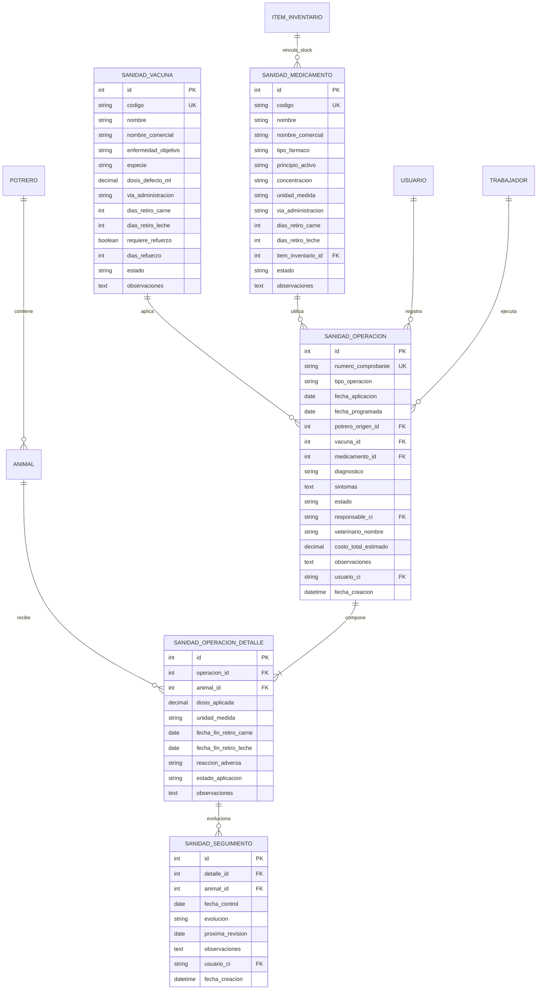

# SPEC-003 — Gestión de Tratamientos y Vacunación del Ganado

## Contexto y objetivo

El submódulo Tratamientos y Vacunación pertenece al módulo Ganadería y tiene como objetivo administrar el historial sanitario del ganado, permitiendo registrar, planificar, controlar y consultar las vacunaciones, tratamientos veterinarios, medicamentos aplicados, enfermedades, síntomas, controles y seguimientos realizados a los animales. El sistema deberá permitir gestionar las operaciones de forma individual o grupal, facilitando la selección de animales por número de arete, código interno, potrero, lote o criterios de búsqueda. Cada operación deberá mantener un historial individual asociado al animal, incluso cuando haya sido registrada para un grupo completo. El sistema deberá permitir programar próximas aplicaciones, refuerzos, revisiones y controles, mostrar pendientes y vencimientos, registrar los resultados del tratamiento y mantener la trazabilidad sanitaria del ganado. Este submódulo deberá integrarse con Registro / Identificación del Ganado, Gestión de Potreros y Movimiento de Ganado y, cuando corresponda, con Inventario y Contabilidad, evitando duplicación de registros y manteniendo la información sanitaria centralizada.

---

# Usuarios / actores

- Administrador o propietario del establecimiento.
- Encargado de ganado.
- Veterinario.
- Personal autorizado para registrar aplicaciones.
- Personal autorizado para consultar historial sanitario.
- Usuario autorizado para gestionar vacunas, medicamentos y tratamientos.

---

# Historias de usuario

H1: Como administrador, quiero registrar vacunas aplicadas a los animales para mantener un historial sanitario completo.

H2: Como encargado, quiero registrar vacunaciones individualmente o por grupo para agilizar las campañas sanitarias.

H3: Como usuario, quiero planificar vacunaciones futuras para organizar las campañas y evitar olvidos.

H4: Como usuario, quiero consultar las vacunaciones pendientes, próximas y vencidas para controlar el cumplimiento del calendario sanitario.

H5: Como usuario, quiero consultar el historial de vacunas de un animal para conocer qué vacunas recibió y cuándo.

H6: Como usuario, quiero registrar tratamientos veterinarios para conocer las enfermedades, síntomas, medicamentos y procedimientos realizados.

H7: Como usuario, quiero registrar tratamientos individualmente o para varios animales para facilitar el manejo sanitario del ganado.

H8: Como usuario, quiero registrar la dosis, vía de administración, duración y responsable del tratamiento para mantener trazabilidad.

H9: Como usuario, quiero registrar controles y seguimientos de tratamientos para conocer la evolución de los animales.

H10: Como usuario, quiero registrar tratamientos preventivos, desparasitaciones y otras aplicaciones sanitarias para mantener el control de la salud del ganado.

H11: Como usuario, quiero programar próximas dosis, controles y tratamientos para recibir recordatorios.

H12: Como usuario, quiero consultar todos los registros sanitarios de un animal desde su perfil para tener una visión completa de su historial.

H13: Como usuario, quiero consultar el historial sanitario por potrero para conocer los tratamientos y vacunaciones realizados en los animales de una ubicación.

H14: Como administrador, quiero administrar un catálogo de vacunas y medicamentos para reutilizar la información en los registros.

H15: Como usuario, quiero registrar el resultado de un tratamiento para conocer si el animal se recuperó, continúa en tratamiento o requiere otra revisión.

H16: Como usuario, quiero registrar tratamientos grupales y mantener un registro individual por cada animal para asegurar la trazabilidad.

H17: Como administrador, quiero consultar estadísticas sanitarias para conocer el estado general del ganado.

H18: Como usuario, quiero registrar información de retiro o tiempo de espera de carne y leche cuando corresponda para controlar las restricciones derivadas de tratamientos veterinarios.

H19: Como usuario, quiero consultar las alertas sanitarias pendientes para saber qué animales requieren atención.

H20: Como usuario, quiero corregir errores de registros sanitarios mediante un procedimiento controlado sin perder el historial original.

---

# Requisitos funcionales (criterios de aceptación en EARS)

# A. Acceso y estructura del submódulo

## RF-1 — Acceso al submódulo

CUANDO el usuario ingrese al módulo Ganadería, EL SISTEMA deberá mostrar el acceso al submódulo Tratamientos y Vacunación dentro de la estructura de navegación del módulo.

EL SISTEMA deberá mantener la estructura, estilos y navegación existentes del ERP.

## RF-2 — Panel general sanitario

CUANDO el usuario ingrese al submódulo, EL SISTEMA deberá mostrar un panel general con información resumida del estado sanitario del establecimiento.

EL SISTEMA deberá mostrar indicadores como:

- Vacunaciones realizadas.
- Vacunaciones pendientes.
- Vacunaciones próximas.
- Vacunaciones vencidas.
- Tratamientos activos.
- Tratamientos pendientes.
- Controles próximos.
- Animales en seguimiento.
- Animales con alertas sanitarias.

Los indicadores deberán obtenerse de los registros existentes.

## RF-3 — Navegación interna

EL SISTEMA deberá permitir acceder a las siguientes áreas:

- Panel general.
- Vacunación.
- Tratamientos.
- Planificación sanitaria.
- Historial sanitario.
- Catálogo de vacunas.
- Catálogo de medicamentos.
- Seguimientos y controles.
- Alertas.

La disponibilidad de las áreas deberá respetar los permisos del usuario.

---

# B. Registro de vacunación

## RF-4 — Registrar vacunación

CUANDO el usuario seleccione Registrar vacunación, EL SISTEMA deberá permitir crear un registro de aplicación de vacuna.

EL SISTEMA deberá solicitar como mínimo:

- Vacuna.
- Fecha de aplicación.
- Animales a vacunar.
- Dosis aplicada, cuando corresponda.
- Responsable, opcional.
- Veterinario, opcional.
- Observaciones, opcionales.

EL SISTEMA deberá permitir registrar vacunaciones individuales o grupales.

## RF-5 — Selección de animales

EL SISTEMA deberá permitir seleccionar animales mediante:

- Número de arete.
- Código interno.
- Nombre, si existe.
- Potrero actual.
- Selección individual.
- Selección múltiple.
- Selección de todos los animales de un potrero.
- Selección de animales según filtros disponibles.

EL SISTEMA deberá mostrar los animales seleccionados antes de confirmar la vacunación.

## RF-6 — Selección grupal por potrero

CUANDO el usuario seleccione un potrero, EL SISTEMA deberá mostrar los animales activos actualmente ubicados en ese potrero.

EL SISTEMA deberá permitir seleccionar todos los animales del potrero o solamente algunos.

EL SISTEMA deberá permitir realizar una vacunación grupal sobre la selección.

EL SISTEMA deberá generar registros sanitarios individuales para cada animal incluido en la operación.

## RF-7 — Selección grupal personalizada

EL SISTEMA deberá permitir seleccionar animales pertenecientes a diferentes potreros.

EL SISTEMA deberá permitir seleccionar una combinación personalizada de animales.

EL SISTEMA deberá mostrar la cantidad total de animales seleccionados.

EL SISTEMA deberá permitir revisar y modificar la selección antes de confirmar.

## RF-8 — Información de la vacuna aplicada

EL SISTEMA deberá permitir registrar:

- Nombre de la vacuna.
- Producto o nombre comercial, si corresponde.
- Enfermedad objetivo, si corresponde.
- Lote del producto, si se conoce.
- Fecha de vencimiento del producto, si se conoce.
- Dosis aplicada.
- Unidad de medida.
- Vía de administración, cuando corresponda.
- Fecha de aplicación.
- Responsable.
- Veterinario.
- Observaciones.

Los campos que no sean obligatorios deberán poder quedar vacíos.

## RF-9 — Registro individual de aplicación

CUANDO se confirme una vacunación individual, EL SISTEMA deberá guardar la aplicación asociada al animal seleccionado.

EL SISTEMA deberá incluir la aplicación en el historial sanitario individual.

EL SISTEMA deberá actualizar el estado de la vacunación correspondiente.

## RF-10 — Registro grupal de vacunación

CUANDO el usuario confirme una vacunación grupal, EL SISTEMA deberá registrar la campaña u operación grupal y generar un registro individual de aplicación para cada animal vacunado.

EL SISTEMA deberá conservar la relación entre los registros individuales y la operación grupal original.

EL SISTEMA deberá permitir consultar posteriormente qué animales participaron en la operación.

EL SISTEMA deberá permitir identificar cuáles animales fueron vacunados y cuáles quedaron pendientes.

## RF-11 — Confirmación de vacunación

CUANDO el usuario intente confirmar una vacunación, EL SISTEMA deberá mostrar un resumen con:

- Vacuna.
- Fecha.
- Cantidad de animales.
- Identificación de los animales.
- Dosis.
- Responsable.
- Veterinario.
- Observaciones.

EL SISTEMA deberá permitir confirmar o cancelar.

## RF-12 — Historial de vacunación

EL SISTEMA deberá mantener un historial de las vacunas aplicadas a cada animal.

El historial deberá mostrar:

- Vacuna.
- Fecha de aplicación.
- Dosis.
- Lote, si fue registrado.
- Responsable.
- Veterinario.
- Próxima aplicación, si corresponde.
- Observaciones.

EL SISTEMA deberá permitir consultar el historial desde el perfil del animal.

## RF-13 — Próxima dosis o refuerzo

EL SISTEMA deberá permitir registrar una próxima dosis o fecha de refuerzo cuando corresponda.

EL SISTEMA deberá permitir:

- Registrar fecha de próxima aplicación.
- Registrar observaciones.
- Programar recordatorio.
- Consultar el estado de la próxima aplicación.

EL SISTEMA no deberá asumir automáticamente que todas las vacunas requieren refuerzo.

## RF-14 — Estado de vacunación

EL SISTEMA deberá permitir identificar los registros de vacunación mediante estados como:

- Planificada.
- Pendiente.
- Aplicada.
- Vencida.
- Cancelada.
- Parcial.

EL SISTEMA deberá actualizar el estado de acuerdo con las fechas y acciones registradas.

---

# C. Planificación de vacunaciones

## RF-15 — Planificar vacunación

CUANDO el usuario seleccione Planificar vacunación, EL SISTEMA deberá permitir registrar una vacunación futura.

EL SISTEMA deberá solicitar:

- Nombre o descripción de la planificación.
- Vacuna.
- Fecha planificada.
- Animales o grupo objetivo.
- Potrero o potreros, cuando corresponda.
- Responsable, opcional.
- Observaciones, opcionales.

## RF-16 — Planificación individual

EL SISTEMA deberá permitir planificar una vacunación para un animal específico.

EL SISTEMA deberá asociar la planificación al animal.

## RF-17 — Planificación grupal

EL SISTEMA deberá permitir planificar una vacunación para varios animales.

EL SISTEMA deberá permitir seleccionar animales por potrero o de forma personalizada.

EL SISTEMA deberá conservar la composición del grupo seleccionado al momento de crear la planificación.

## RF-18 — Cumplimiento de planificación

CUANDO una vacunación planificada sea realizada, EL SISTEMA deberá permitir registrar la aplicación y actualizar el estado de la planificación.

EL SISTEMA deberá permitir identificar qué animales fueron vacunados y cuáles siguen pendientes.

## RF-19 — Vacunación parcial

CUANDO solamente una parte de los animales de una planificación grupal sea vacunada, EL SISTEMA deberá permitir registrar la aplicación de los animales que recibieron la vacuna.

EL SISTEMA deberá mantener pendientes los animales restantes.

EL SISTEMA deberá permitir completar la planificación posteriormente.

## RF-20 — Cancelación de planificación

EL SISTEMA deberá permitir cancelar una vacunación planificada.

EL SISTEMA deberá solicitar confirmación.

EL SISTEMA deberá conservar el registro de la planificación cancelada.

EL SISTEMA no deberá generar aplicaciones de vacuna por una planificación cancelada.

---

# D. Tratamientos veterinarios

## RF-21 — Registrar tratamiento

CUANDO el usuario seleccione Registrar tratamiento, EL SISTEMA deberá permitir crear un registro de tratamiento veterinario para uno o varios animales.

EL SISTEMA deberá permitir registrar como mínimo:

- Animal o animales.
- Fecha de inicio.
- Motivo del tratamiento.
- Diagnóstico, cuando exista.
- Síntomas, cuando existan.
- Medicamento o producto utilizado, cuando corresponda.
- Dosis.
- Unidad de medida.
- Vía de administración.
- Frecuencia.
- Duración.
- Responsable.
- Veterinario.
- Observaciones.

EL SISTEMA deberá permitir registrar tratamientos individuales o grupales.

## RF-22 — Motivo del tratamiento

EL SISTEMA deberá permitir registrar el motivo del tratamiento.

Los motivos podrán incluir:

- Enfermedad.
- Síntomas.
- Tratamiento preventivo.
- Desparasitación.
- Infección.
- Lesión.
- Problema digestivo.
- Problema respiratorio.
- Problema reproductivo.
- Tratamiento sanitario rutinario.
- Otro.

EL SISTEMA deberá permitir ingresar un motivo personalizado cuando se seleccione Otro.

## RF-23 — Diagnóstico

EL SISTEMA deberá permitir registrar un diagnóstico cuando exista.

El diagnóstico podrá ser ingresado por un veterinario o usuario autorizado.

EL SISTEMA deberá permitir dejar el diagnóstico vacío cuando todavía no exista un diagnóstico confirmado.

## RF-24 — Síntomas

EL SISTEMA deberá permitir registrar los síntomas observados.

EL SISTEMA deberá permitir registrar uno o varios síntomas.

EL SISTEMA deberá permitir agregar una descripción personalizada.

## RF-25 — Medicamento utilizado

EL SISTEMA deberá permitir registrar uno o varios medicamentos utilizados en un tratamiento.

Por cada medicamento deberá permitir registrar, cuando corresponda:

- Nombre.
- Producto.
- Dosis.
- Unidad.
- Vía de administración.
- Frecuencia.
- Duración.
- Cantidad utilizada.
- Lote.
- Fecha de vencimiento.
- Observaciones.

EL SISTEMA deberá permitir registrar tratamientos que no utilicen medicamentos, cuando correspondan a procedimientos u otras intervenciones sanitarias.

## RF-26 — Tratamiento individual

CUANDO el usuario registre un tratamiento individual, EL SISTEMA deberá asociar el tratamiento al animal seleccionado.

EL SISTEMA deberá guardar el tratamiento en el historial sanitario individual.

## RF-27 — Tratamiento grupal

EL SISTEMA deberá permitir registrar tratamientos para varios animales.

EL SISTEMA deberá permitir seleccionar animales por:

- Potrero.
- Número de arete.
- Código interno.
- Selección múltiple.
- Filtros disponibles.

EL SISTEMA deberá generar registros individuales asociados a cada animal.

EL SISTEMA deberá conservar la relación con el tratamiento grupal original.

## RF-28 — Tratamiento parcial

CUANDO solamente algunos animales de un grupo reciban el tratamiento, EL SISTEMA deberá permitir registrar únicamente los animales tratados.

EL SISTEMA deberá mantener identificados los animales pendientes de tratamiento.

## RF-29 — Confirmación de tratamiento

CUANDO el usuario confirme un tratamiento, EL SISTEMA deberá mostrar un resumen con:

- Animales seleccionados.
- Motivo.
- Diagnóstico.
- Medicamento o productos.
- Dosis.
- Fecha.
- Responsable.
- Veterinario.
- Duración.
- Observaciones.

EL SISTEMA deberá permitir confirmar o cancelar.

## RF-30 — Estado del tratamiento

EL SISTEMA deberá permitir identificar el estado de un tratamiento:

- Planificado.
- Pendiente.
- En curso.
- Completado.
- Suspendido.
- Cancelado.
- Requiere seguimiento.

EL SISTEMA deberá actualizar el estado según las acciones registradas.

## RF-31 — Tratamiento de varios días

EL SISTEMA deberá permitir registrar tratamientos cuya duración sea de varios días.

EL SISTEMA deberá permitir registrar:

- Fecha de inicio.
- Fecha prevista de finalización.
- Frecuencia.
- Aplicaciones realizadas.
- Aplicaciones pendientes.
- Estado.

EL SISTEMA deberá permitir registrar cada aplicación cuando el tratamiento requiera varias administraciones.

## RF-32 — Aplicaciones de tratamiento

EL SISTEMA deberá permitir registrar las aplicaciones individuales de un tratamiento.

Cada aplicación deberá poder incluir:

- Fecha.
- Hora, opcional.
- Dosis.
- Producto utilizado.
- Responsable.
- Observaciones.

EL SISTEMA deberá mantener el historial de aplicaciones.

## RF-33 — Seguimiento del tratamiento

EL SISTEMA deberá permitir registrar controles posteriores al tratamiento.

Cada control deberá permitir registrar:

- Fecha del control.
- Estado del animal.
- Síntomas observados.
- Evolución.
- Resultado.
- Observaciones.
- Responsable.
- Próxima revisión, cuando corresponda.

## RF-34 — Resultado del tratamiento

EL SISTEMA deberá permitir registrar el resultado de un tratamiento.

Los resultados podrán incluir:

- Recuperado.
- Mejoría.
- Sin mejoría.
- Continúa en tratamiento.
- Requiere nuevo tratamiento.
- Derivado a veterinario.
- Otro.

EL SISTEMA deberá permitir agregar observaciones sobre el resultado.

## RF-35 — Tratamiento finalizado

CUANDO un tratamiento sea marcado como completado, EL SISTEMA deberá conservar todas sus aplicaciones y controles.

EL SISTEMA deberá permitir consultar el tratamiento desde el historial sanitario del animal.

## RF-36 — Tratamiento suspendido

EL SISTEMA deberá permitir suspender un tratamiento.

EL SISTEMA deberá registrar la fecha de suspensión y el motivo, cuando se proporcionen.

EL SISTEMA deberá conservar el historial de las aplicaciones realizadas antes de la suspensión.

---

# E. Tratamientos preventivos y desparasitación

## RF-37 — Registro preventivo

EL SISTEMA deberá permitir registrar tratamientos preventivos.

EL SISTEMA deberá permitir clasificarlos como preventivos.

## RF-38 — Desparasitación

EL SISTEMA deberá permitir registrar desparasitaciones como parte del historial sanitario.

EL SISTEMA deberá permitir registrar:

- Fecha.
- Animal o grupo.
- Producto.
- Dosis.
- Responsable.
- Observaciones.
- Próxima aplicación, cuando corresponda.

## RF-39 — Próximos tratamientos preventivos

EL SISTEMA deberá permitir planificar futuras aplicaciones preventivas.

EL SISTEMA deberá permitir consultar las aplicaciones pendientes.

EL SISTEMA deberá permitir registrar la aplicación realizada y actualizar su estado.

---

# F. Restricciones y tiempos de espera

## RF-40 — Tiempo de retiro

EL SISTEMA deberá permitir registrar un tiempo de retiro o espera cuando corresponda al producto o tratamiento aplicado.

EL SISTEMA deberá permitir registrar:

- Tiempo de retiro.
- Unidad de tiempo.
- Fecha estimada de finalización.
- Tipo de restricción, cuando corresponda.
- Observaciones.

## RF-41 — Restricción por retiro

CUANDO un animal tenga un tiempo de retiro activo registrado, EL SISTEMA deberá mostrar una advertencia en su perfil y en las consultas correspondientes.

EL SISTEMA deberá permitir identificar que el animal se encuentra bajo restricción de retiro.

EL SISTEMA deberá mostrar la fecha estimada en que finalizará el período de retiro.

## RF-42 — Consulta de animales bajo retiro

EL SISTEMA deberá permitir consultar los animales que tengan un período de retiro activo.

EL SISTEMA deberá permitir filtrar por tipo de restricción y fecha estimada de finalización.

EL SISTEMA deberá mantener el historial de restricciones asociadas a los tratamientos.

---

# G. Historial sanitario

## RF-43 — Historial sanitario individual

EL SISTEMA deberá mantener un historial sanitario centralizado por animal.

El historial deberá incluir:

- Vacunaciones.
- Tratamientos.
- Medicamentos.
- Desparasitaciones.
- Diagnósticos.
- Síntomas.
- Controles.
- Seguimientos.
- Próximas aplicaciones.
- Resultados.
- Restricciones de retiro.

## RF-44 — Acceso desde el perfil del animal

CUANDO el usuario consulte el perfil de un animal, EL SISTEMA deberá permitir acceder a su historial sanitario.

EL SISTEMA deberá permitir visualizar los registros cronológicamente.

EL SISTEMA deberá permitir filtrar el historial por tipo de operación.

## RF-45 — Historial cronológico

EL SISTEMA deberá mostrar los registros sanitarios ordenados por fecha.

EL SISTEMA deberá permitir identificar la fecha de cada operación.

EL SISTEMA deberá permitir abrir el detalle de un registro.

## RF-46 — Historial por potrero

EL SISTEMA deberá permitir consultar registros sanitarios asociados a los animales que actualmente se encuentran en un potrero.

EL SISTEMA deberá permitir consultar vacunaciones y tratamientos realizados en animales que estuvieron anteriormente en un potrero, cuando se utilicen filtros históricos.

## RF-47 — Historial por animal

EL SISTEMA deberá permitir consultar todos los registros sanitarios de un animal mediante su número de arete o código interno.

EL SISTEMA deberá permitir buscar animales incluso si no tienen número de arete, utilizando el código interno.

---

# H. Alertas y planificación

## RF-48 — Vacunaciones próximas

EL SISTEMA deberá identificar vacunaciones cuya fecha planificada se encuentre próxima.

EL SISTEMA deberá permitir configurar el período de anticipación de las alertas.

## RF-49 — Vacunaciones vencidas

EL SISTEMA deberá identificar vacunaciones planificadas cuya fecha haya pasado y no hayan sido registradas como aplicadas o canceladas.

## RF-50 — Próximos tratamientos

EL SISTEMA deberá identificar tratamientos, aplicaciones o controles próximos.

## RF-51 — Tratamientos pendientes

EL SISTEMA deberá mostrar tratamientos que se encuentren pendientes de aplicación.

## RF-52 — Seguimientos pendientes

EL SISTEMA deberá identificar animales que requieran seguimiento o control posterior.

## RF-53 — Alertas sanitarias

EL SISTEMA deberá mostrar alertas relacionadas con:

- Vacunaciones próximas.
- Vacunaciones vencidas.
- Tratamientos pendientes.
- Aplicaciones pendientes.
- Controles próximos.
- Tratamientos que requieren seguimiento.
- Períodos de retiro activos.
- Productos próximos a vencer, si se integra el inventario.

## RF-54 — Recordatorios

EL SISTEMA deberá permitir consultar recordatorios sanitarios.

EL SISTEMA deberá permitir identificar el animal, grupo o campaña relacionado con el recordatorio.

---

# I. Catálogo de vacunas

## RF-55 — Catálogo de vacunas

EL SISTEMA deberá permitir administrar un catálogo de vacunas.

Cada vacuna deberá permitir registrar:

- Código.
- Nombre.
- Nombre comercial.
- Enfermedad objetivo.
- Especie.
- Descripción.
- Dosis de referencia, opcional.
- Unidad de dosis.
- Vía de administración, opcional.
- Intervalo o refuerzo, opcional.
- Observaciones.
- Estado.

## RF-56 — Crear vacuna

EL SISTEMA deberá permitir registrar nuevas vacunas en el catálogo.

EL SISTEMA deberá validar los campos obligatorios.

## RF-57 — Editar vacuna

EL SISTEMA deberá permitir editar información de vacunas existentes.

EL SISTEMA deberá conservar la información histórica de las aplicaciones previamente registradas.

## RF-58 — Desactivar vacuna

EL SISTEMA deberá permitir desactivar vacunas.

EL SISTEMA deberá impedir que las vacunas desactivadas se seleccionen en nuevas aplicaciones, salvo que exista una autorización especial definida por el sistema.

EL SISTEMA deberá conservar su historial.

---

# J. Catálogo de medicamentos y productos sanitarios

## RF-59 — Catálogo de medicamentos

EL SISTEMA deberá permitir administrar un catálogo de medicamentos y productos sanitarios.

Cada medicamento deberá permitir registrar:

- Código.
- Nombre.
- Nombre comercial.
- Tipo.
- Descripción.
- Unidad de medida.
- Presentación.
- Vía de administración, cuando corresponda.
- Observaciones.
- Estado.

## RF-60 — Crear medicamento

EL SISTEMA deberá permitir registrar medicamentos y productos sanitarios.

EL SISTEMA deberá validar la información obligatoria.

## RF-61 — Editar medicamento

EL SISTEMA deberá permitir editar la información del medicamento.

EL SISTEMA deberá conservar la información histórica de tratamientos que utilicen ese medicamento.

## RF-62 — Desactivar medicamento

EL SISTEMA deberá permitir desactivar medicamentos.

EL SISTEMA deberá impedir que medicamentos desactivados sean utilizados en nuevos registros, salvo que exista una autorización definida.

EL SISTEMA deberá conservar el historial.

---

# K. Integración con inventario

## RF-63 — Integración con inventario

EL SISTEMA deberá permitir integrar vacunas y medicamentos con el módulo Inventario cuando dicha integración esté habilitada.

EL SISTEMA deberá evitar crear un inventario duplicado de productos sanitarios.

## RF-64 — Registro de consumo

CUANDO se registre una aplicación y exista integración de inventario habilitada, EL SISTEMA deberá permitir registrar el consumo de productos utilizados.

EL SISTEMA deberá permitir relacionar el consumo con:

- Producto.
- Lote.
- Cantidad.
- Unidad.
- Operación sanitaria.
- Animales tratados.

## RF-65 — Descuento de inventario

CUANDO se confirme una aplicación sanitaria con descuento automático habilitado, EL SISTEMA deberá registrar la salida del producto utilizado.

EL SISTEMA deberá actualizar las existencias según las reglas del módulo Inventario.

## RF-66 — Control de lotes

EL SISTEMA deberá permitir registrar el lote del producto utilizado cuando la información esté disponible.

EL SISTEMA deberá permitir consultar los animales que recibieron productos pertenecientes a un lote determinado.

## RF-67 — Vencimiento del producto

EL SISTEMA deberá permitir registrar la fecha de vencimiento del producto utilizado cuando corresponda.

EL SISTEMA deberá advertir sobre productos vencidos cuando exista integración con inventario y control de vencimientos.

---

# L. Edición y corrección de registros

## RF-68 — Editar vacunación

EL SISTEMA deberá permitir editar registros de vacunación según los permisos del usuario.

EL SISTEMA deberá conservar la trazabilidad de modificaciones relevantes.

## RF-69 — Editar tratamiento

EL SISTEMA deberá permitir editar registros de tratamientos según los permisos del usuario.

EL SISTEMA deberá conservar la trazabilidad de modificaciones relevantes.

## RF-70 — Editar planificación

EL SISTEMA deberá permitir modificar fechas, animales, vacuna, tratamiento y observaciones de una planificación, cuando todavía no se haya completado.

## RF-71 — Anular registro sanitario

EL SISTEMA deberá permitir anular registros sanitarios mediante un procedimiento controlado.

EL SISTEMA deberá solicitar confirmación.

EL SISTEMA deberá permitir registrar el motivo de anulación.

EL SISTEMA deberá conservar el registro original para auditoría.

## RF-72 — Duplicados

EL SISTEMA deberá prevenir registros duplicados accidentales de aplicaciones o tratamientos mediante validaciones apropiadas.

EL SISTEMA deberá advertir si existe un registro similar para el mismo animal, producto y fecha.

EL SISTEMA deberá permitir continuar cuando el usuario confirme que se trata de una aplicación legítima adicional.

---

# M. Filtros, búsqueda y reportes

## RF-73 — Buscar animal

EL SISTEMA deberá permitir buscar registros sanitarios por:

- Número de arete.
- Código interno.
- Nombre del animal, cuando exista.

## RF-74 — Filtros de vacunación

EL SISTEMA deberá permitir filtrar vacunaciones por:

- Vacuna.
- Fecha.
- Estado.
- Potrero.
- Animal.
- Responsable.
- Veterinario.
- Campaña.

## RF-75 — Filtros de tratamientos

EL SISTEMA deberá permitir filtrar tratamientos por:

- Medicamento.
- Motivo.
- Diagnóstico.
- Fecha.
- Estado.
- Potrero.
- Animal.
- Responsable.
- Veterinario.

## RF-76 — Reportes sanitarios

EL SISTEMA deberá permitir consultar reportes de:

- Vacunaciones realizadas.
- Vacunaciones pendientes.
- Vacunaciones vencidas.
- Tratamientos realizados.
- Tratamientos activos.
- Tratamientos pendientes.
- Animales en seguimiento.
- Animales con restricciones de retiro.
- Historial sanitario por animal.
- Historial sanitario por potrero.
- Aplicaciones por período.
- Aplicaciones por producto.

## RF-77 — Exportación

EL SISTEMA deberá permitir exportar los reportes sanitarios cuando la funcionalidad de exportación del ERP esté disponible.

EL SISTEMA deberá permitir exportar la información según los filtros aplicados.

---

# N. Integración con otros módulos

## RF-78 — Registro / Identificación del Ganado

EL SISTEMA deberá utilizar los animales existentes en Registro / Identificación del Ganado.

EL SISTEMA deberá utilizar el código interno como identificador único.

EL SISTEMA deberá utilizar el número de arete cuando exista.

EL SISTEMA no deberá duplicar animales.

## RF-79 — Gestión de Potreros

EL SISTEMA deberá permitir utilizar el potrero actual del animal como criterio de selección y consulta.

EL SISTEMA deberá permitir consultar animales sanitariamente tratados o vacunados por potrero.

## RF-80 — Movimientos de ganado

EL SISTEMA deberá respetar la ubicación actual del animal obtenida del módulo de movimientos.

EL SISTEMA no deberá alterar la ubicación del animal por registrar una vacunación o tratamiento.

## RF-81 — Contabilidad

EL SISTEMA deberá permitir integrar gastos sanitarios con Contabilidad cuando corresponda y cuando exista integración habilitada.

EL SISTEMA deberá evitar generar gastos duplicados.

## RF-82 — Auditoría

EL SISTEMA deberá registrar quién creó, editó o anuló los registros sanitarios.

EL SISTEMA deberá conservar la fecha y hora de las operaciones.

---

# Requisitos no funcionales

## RNF-1 — Usabilidad

La interfaz deberá ser clara, intuitiva y sencilla.

EL SISTEMA deberá facilitar la selección grupal de animales.

EL SISTEMA deberá minimizar la cantidad de pasos necesarios para registrar una vacunación o tratamiento.

EL SISTEMA deberá permitir revisar los animales seleccionados antes de confirmar una operación grupal.

## RNF-2 — Rendimiento

EL SISTEMA deberá responder de manera fluida al consultar historial, filtrar animales y registrar aplicaciones.

EL SISTEMA deberá permitir gestionar grupos de animales sin generar demoras innecesarias.

## RNF-3 — Integridad

EL SISTEMA deberá garantizar que los registros sanitarios estén correctamente relacionados con los animales.

EL SISTEMA deberá evitar registros parciales de operaciones grupales.

EL SISTEMA deberá mantener la consistencia entre planificaciones, aplicaciones y estados.

## RNF-4 — Seguridad

EL SISTEMA deberá requerir autenticación para registrar, modificar o anular información sanitaria.

EL SISTEMA deberá respetar los permisos de los usuarios.

## RNF-5 — Trazabilidad

EL SISTEMA deberá conservar el historial de operaciones sanitarias.

EL SISTEMA deberá registrar quién realizó cada operación y cuándo.

EL SISTEMA deberá permitir rastrear las aplicaciones grupales hasta sus registros individuales.

## RNF-6 — Responsividad

EL SISTEMA deberá ser responsivo y adaptarse a:

- Computadoras de escritorio.
- Laptops.
- Tabletas.
- Teléfonos móviles.

EL SISTEMA deberá permitir utilizar las funciones principales en pantallas pequeñas.

Los formularios, tablas, filtros y paneles deberán adaptarse al tamaño de pantalla.

EL SISTEMA deberá evitar desbordamientos horizontales innecesarios.

## RNF-7 — Compatibilidad

EL SISTEMA deberá integrarse con la estructura, estilos, navegación y arquitectura existente del ERP.

## RNF-8 — Escalabilidad

EL SISTEMA deberá permitir gestionar un número creciente de animales, tratamientos, vacunaciones y registros históricos.

## RNF-9 — Idioma

La interfaz deberá estar disponible en español.

## RNF-10 — Datos veterinarios

EL SISTEMA deberá permitir registrar las indicaciones veterinarias proporcionadas por un profesional.

EL SISTEMA no deberá establecer diagnósticos veterinarios automáticos ni prescribir medicamentos, dosis o protocolos sanitarios sin una funcionalidad específica aprobada para ello.

---

# Casos límite

## CE-1 — Animal sin arete

EL SISTEMA deberá permitir seleccionar al animal mediante su código interno.

## CE-2 — Animal vendido

EL SISTEMA deberá conservar el historial sanitario del animal vendido.

EL SISTEMA deberá impedir incluir animales vendidos en nuevas campañas grupales de animales activos, salvo que exista una consulta histórica explícita.

## CE-3 — Animal dado de baja

EL SISTEMA deberá conservar su historial sanitario.

EL SISTEMA deberá impedir incluirlo en nuevas campañas de animales activos.

## CE-4 — Animal sin potrero

EL SISTEMA deberá permitir encontrarlo mediante su código o número de arete, aunque no tenga potrero asignado.

## CE-5 — Selección vacía

EL SISTEMA deberá impedir confirmar vacunaciones o tratamientos sin animales seleccionados.

## CE-6 — Animal duplicado en selección

EL SISTEMA deberá impedir que un mismo animal sea incluido más de una vez en una operación.

## CE-7 — Vacunación grupal parcialmente realizada

EL SISTEMA deberá permitir registrar únicamente los animales que realmente recibieron la vacuna.

EL SISTEMA deberá mantener pendientes los animales restantes.

## CE-8 — Tratamiento grupal parcialmente realizado

EL SISTEMA deberá permitir registrar tratamientos únicamente para los animales que realmente fueron tratados.

## CE-9 — Registro duplicado

EL SISTEMA deberá advertir sobre aplicaciones duplicadas o registros similares.

## CE-10 — Fecha futura

EL SISTEMA deberá diferenciar una aplicación planificada de una aplicación efectivamente realizada.

EL SISTEMA deberá impedir que una aplicación realizada se registre accidentalmente como una fecha futura sin una validación apropiada.

## CE-11 — Fecha anterior

EL SISTEMA deberá permitir registrar aplicaciones históricas cuando el usuario esté ingresando información que realmente ocurrió anteriormente.

EL SISTEMA deberá identificar claramente la fecha real de aplicación y la fecha de registro.

## CE-12 — Producto sin lote

EL SISTEMA deberá permitir registrar la aplicación sin lote cuando no se conozca o no se haya registrado el lote.

## CE-13 — Producto vencido

CUANDO se seleccione un producto vencido y exista control de vencimientos, EL SISTEMA deberá mostrar una advertencia.

EL SISTEMA deberá aplicar las reglas definidas para impedir o permitir el uso.

## CE-14 — Dosis no registrada

EL SISTEMA deberá permitir dejar la dosis vacía cuando el registro no disponga de esa información y el campo no sea obligatorio.

## CE-15 — Tratamiento sin medicamento

EL SISTEMA deberá permitir registrar procedimientos o intervenciones sanitarias que no utilicen medicamentos.

## CE-16 — Tratamiento de varios días

EL SISTEMA deberá mantener correctamente las aplicaciones realizadas y pendientes.

## CE-17 — Tratamiento suspendido

EL SISTEMA deberá conservar las aplicaciones previas y registrar la suspensión.

## CE-18 — Animal recuperado

EL SISTEMA deberá permitir registrar el resultado del tratamiento y conservar el historial.

## CE-19 — Animal que requiere seguimiento

EL SISTEMA deberá permitir registrar una próxima revisión.

## CE-20 — Restricción de retiro

EL SISTEMA deberá mostrar la restricción correspondiente cuando exista un período de retiro activo.

## CE-21 — Aplicación grupal duplicada

EL SISTEMA deberá impedir la duplicación accidental de registros individuales por reenvío de una operación grupal.

## CE-22 — Error de conexión

EL SISTEMA deberá informar el error y evitar que la operación quede parcialmente registrada.

## CE-23 — Concurrencia

EL SISTEMA deberá prevenir inconsistencias cuando varios usuarios registren operaciones sanitarias sobre el mismo animal simultáneamente.

## CE-24 — Modificación de catálogo

EL SISTEMA deberá conservar los registros históricos aunque una vacuna o medicamento sea editado o desactivado.

## CE-25 — Anulación

EL SISTEMA deberá conservar la trazabilidad de registros anulados.

## CE-26 — Tratamiento sin diagnóstico

EL SISTEMA deberá permitir registrar el tratamiento aunque todavía no exista diagnóstico confirmado.

## CE-27 — Planificación cancelada

EL SISTEMA deberá conservar la planificación cancelada sin generar aplicaciones.

## CE-28 — Refuerzo no definido

EL SISTEMA deberá permitir registrar una vacunación sin próxima dosis cuando no corresponda o no se conozca.

## CE-29 — Restricción de retiro no aplicable

EL SISTEMA deberá permitir registrar tratamientos sin período de retiro cuando no corresponda.

## CE-30 — Pantalla pequeña

EL SISTEMA deberá adaptar formularios, listas, paneles y selección de animales a dispositivos móviles.

---

# Fuera de alcance

- Diagnóstico automático de enfermedades mediante inteligencia artificial.
- Prescripción veterinaria automática.
- Recomendación automática de medicamentos.
- Determinación automática de dosis veterinarias.
- Sustitución del criterio del veterinario.
- Monitoreo biométrico automático.
- Integración con dispositivos veterinarios.
- Lectura automática de RFID.
- GPS sanitario.
- Detección automática de enfermedades por sensores.
- Laboratorio clínico integrado.
- Gestión hospitalaria veterinaria avanzada.
- Automatización de tratamientos mediante dispositivos.
- Gestión de reproducción, salvo que posteriormente se integre con tratamientos sanitarios relacionados.
- Gestión avanzada de farmacia veterinaria.
- Control de inventario completo de vacunas y medicamentos, salvo integración definida posteriormente con el módulo Inventario.
- Protocolos veterinarios universales precargados que se apliquen automáticamente sin configuración.
- Diagnóstico o recomendación médica veterinaria por IA.

---

# Criterios de finalización

- [ ] El acceso al submódulo existe dentro de Ganadería.
- [ ] Se muestra el panel general sanitario.
- [ ] Se muestran vacunaciones realizadas.
- [ ] Se muestran vacunaciones pendientes.
- [ ] Se muestran vacunaciones próximas.
- [ ] Se muestran vacunaciones vencidas.
- [ ] Se muestran tratamientos activos.
- [ ] Se muestran seguimientos pendientes.
- [ ] Se puede registrar vacunación individual.
- [ ] Se puede registrar vacunación grupal.
- [ ] Se pueden seleccionar animales por arete.
- [ ] Se pueden seleccionar animales por código interno.
- [ ] Se pueden seleccionar animales por potrero.
- [ ] Se pueden seleccionar animales individualmente.
- [ ] Se pueden seleccionar múltiples animales.
- [ ] Se puede seleccionar un grupo completo.
- [ ] Se puede realizar una selección personalizada.
- [ ] Se genera historial individual por animal.
- [ ] Se conserva la relación con la operación grupal.
- [ ] Se puede planificar vacunación.
- [ ] Se puede registrar una vacunación planificada como realizada.
- [ ] Se puede registrar vacunación parcial.
- [ ] Se pueden registrar próximas dosis.
- [ ] Se pueden consultar vacunaciones pendientes.
- [ ] Se pueden consultar vacunaciones vencidas.
- [ ] Se puede registrar tratamiento individual.
- [ ] Se puede registrar tratamiento grupal.
- [ ] Se pueden registrar síntomas.
- [ ] Se puede registrar diagnóstico.
- [ ] Se pueden registrar medicamentos.
- [ ] Se puede registrar dosis y unidad.
- [ ] Se puede registrar vía de administración.
- [ ] Se puede registrar frecuencia.
- [ ] Se puede registrar duración.
- [ ] Se pueden registrar tratamientos de varios días.
- [ ] Se pueden registrar aplicaciones individuales.
- [ ] Se pueden registrar controles posteriores.
- [ ] Se puede registrar evolución del animal.
- [ ] Se puede registrar resultado del tratamiento.
- [ ] Se puede marcar tratamiento como completado.
- [ ] Se puede suspender tratamiento.
- [ ] Se pueden registrar tratamientos preventivos.
- [ ] Se pueden registrar desparasitaciones.
- [ ] Se pueden planificar aplicaciones preventivas.
- [ ] Se puede registrar tiempo de retiro cuando corresponda.
- [ ] Se muestran restricciones de retiro activas.
- [ ] Se puede consultar historial sanitario individual.
- [ ] Se puede consultar historial por potrero.
- [ ] Se puede filtrar historial.
- [ ] Se puede buscar animal por arete.
- [ ] Se puede buscar animal por código interno.
- [ ] Se pueden consultar alertas.
- [ ] Se pueden consultar vacunaciones próximas.
- [ ] Se pueden consultar vacunaciones vencidas.
- [ ] Se pueden consultar tratamientos pendientes.
- [ ] Se pueden consultar seguimientos pendientes.
- [ ] Existe catálogo de vacunas.
- [ ] Se pueden crear vacunas.
- [ ] Se pueden editar vacunas.
- [ ] Se pueden desactivar vacunas.
- [ ] Existe catálogo de medicamentos.
- [ ] Se pueden crear medicamentos.
- [ ] Se pueden editar medicamentos.
- [ ] Se pueden desactivar medicamentos.
- [ ] Se conserva el historial de productos desactivados.
- [ ] Se pueden registrar lotes.
- [ ] Se pueden registrar vencimientos.
- [ ] La integración con Inventario no genera productos duplicados.
- [ ] Se puede registrar consumo cuando la integración está habilitada.
- [ ] Se evita el descuento duplicado de inventario.
- [ ] Se puede editar vacunación.
- [ ] Se puede editar tratamiento.
- [ ] Se puede editar planificación.
- [ ] Se pueden anular registros de forma controlada.
- [ ] Se conserva la trazabilidad de modificaciones.
- [ ] Se advierten registros duplicados.
- [ ] Se puede consultar reportes sanitarios.
- [ ] Se pueden exportar reportes cuando la funcionalidad esté disponible.
- [ ] Se integra con Registro / Identificación del Ganado.
- [ ] Se integra con Gestión de Potreros.
- [ ] Se integra con Movimiento de Ganado.
- [ ] Se mantiene la ubicación actual del animal sin modificarla.
- [ ] Se respeta la autenticación y permisos.
- [ ] Se registra quién creó, editó o anuló los registros.
- [ ] La interfaz es responsiva.
- [ ] Funciona correctamente en computadora.
- [ ] Funciona correctamente en tableta.
- [ ] Funciona correctamente en teléfono móvil.
- [ ] Los formularios se adaptan a pantallas pequeñas.
- [ ] Los registros grupales mantienen la integridad de los datos.
- [ ] Todos los requisitos funcionales tienen pruebas satisfactorias.
- [ ] Se realiza una demostración manual de los flujos principales.

---

# O. Dudas Resueltas y Decisiones de Arquitectura

Tras el análisis integral de `spec.md`, `spec2.md` y las consultas de requerimiento, se definen las siguientes decisiones de diseño técnico:

### D-01 — Integración con Inventario de Medicamentos y Vacunas
**Resolución:** **Modo Híbrido.** El submódulo de Sanidad permite el registro clínico ágil e independiente sin exigir stock previo obligatorio. Sin embargo, si una vacuna o medicamento está vinculado a un `item_inventario_id`, el sistema ofrece un interruptor opcional *"Descontar del inventario"* que descuenta automáticamente las unidades consumidas en la tabla `movimiento_inventario` con motivo `SALIDA_USO_VETERINARIO`.

### D-02 — Conexión con Gestión de Potreros y Cartografía (SPEC-002)
**Resolución:** **Selección Masiva por Potrero y Aislamiento Preventivo.**
1. En campañas grupales de vacunación o desparasitación, el operador puede seleccionar un potrero (ej: *Potrero A*) y el sistema carga automáticamente todos los animales activos presentes en ese polígono con un solo clic.
2. Si un animal recibe un diagnóstico infeccioso o que requiera aislamiento, el formulario ofrece la opción: *"¿Trasladar a Corral de Cuarentena?"*. Si se confirma, el sistema registra automáticamente el traslado atómico en `movimiento_ganado` y actualiza las coordenadas del animal en el mapa satelital.

### D-03 — Período de Retiro (Carne / Leche) y Control en Ventas (SPEC-001)
**Resolución:** **Alerta Preventiva y Visibilidad 360°.**
1. Cada vacuna o medicamento define sus días de retiro de carne y leche. El sistema calcula `fecha_fin_retiro = fecha_aplicacion + dias_retiro`.
2. En el Perfil 360 del Animal se muestra un badge ámbar prominente: `⚠️ En período de retiro hasta DD/MM/AAAA`.
3. En el formulario de *Venta de Ganado* (`spec.md`), si el usuario intenta seleccionar un animal con retiro activo, el sistema emite una alerta preventiva que exige confirmación explícita para evitar la comercialización accidental de animales medicados.

### D-04 — Arquitectura y Responsividad ("Modo Manga / Trabajo en Corral")
**Resolución:** **Diseño Adaptativo con Touch Targets $\ge 48\text{px}$.**
1. **En PC/Laptops:** Panel con KPIs sanitarios, calendario de vacunación, filtros avanzados y tablas completas.
2. **En Celular / Tablet (< 768px):** Se activa el **Modo Manga**, optimizado para operadores con guantes y bajo el sol:
   - Búsqueda táctil rápida por arete o código interno.
   - Lista compacta tipo checklist táctil con botones grandes de 48px de altura (fáciles de pulsar con una sola mano).
   - Barra flotante inferior que indica en tiempo real: `Vacunados: X | Pendientes: Y | Total: Z`.

### D-05 — Catálogo de Fármacos y Vacunas Precargadas
**Resolución:** Catálogo configurable por el usuario con registros base iniciales de la ganadería bovina boliviana:
- **Vacunas:** Fiebre Aftosa (bivalente O/A), Rabia Paresiante, Clostridiosis (Mancha/Gangrena/Enterotoxemia), Brucelosis B19 / RB51.
- **Medicamentos:** Ivermectina 1% y 3.15%, Oxitetraciclina L.A., Complejo B + Hierro, Albendazol 10%, Flunixin Meglumine, Curabichera en pasta/spray.

### D-06 — Responsable y Veterinario
**Resolución:** Selector vinculado a la tabla `trabajador` del ERP para personal interno, con un campo alternativo de texto libre para veterinarios o técnicos externos independientes.

### D-07 — Registro de Complicaciones y Reacciones Adversas
**Resolución:** En el detalle de aplicación por animal, se incluye el campo `reaccion_adversa: Optional[str]`, permitiendo registrar alergias, inflamación local o shock anafiláctico con fecha y hora.

### D-08 — Carga de Registros Sanitarios Históricos
**Resolución:** Se permite registrar vacunaciones y tratamientos anteriores a la puesta en marcha del ERP especificando la `fecha_aplicacion` histórica real, distinguiéndola de la `fecha_creacion` del sistema.

---

# P. Arquitectura del Modelo de Datos (Mermaid y Persistencia)

A continuación se detalla el esquema relacional normalizado en PostgreSQL:



---

# Q. Endpoints de la API REST (FastAPI)

Todos los endpoints respetan el prefijo `/api/v1/ganaderia/sanidad` y la seguridad JWT RBAC:

| Método | Endpoint | Permiso Requerido | Descripción |
| :--- | :--- | :--- | :--- |
| `GET` | `/kpis` | `GANADERIA_VER` | KPIs sanitarios consolidados (vacunaciones del mes, tratamientos activos, retiros vigentes). |
| `GET` | `/vacunas` | `GANADERIA_VER` | Lista de vacunas activas del catálogo. |
| `POST` | `/vacunas` | `GANADERIA_CREAR` | Crea una nueva vacuna en el catálogo. |
| `PUT` | `/vacunas/{id}` | `GANADERIA_EDITAR` | Actualiza información técnica de una vacuna. |
| `PATCH` | `/vacunas/{id}/desactivar` | `GANADERIA_EDITAR` | Desactiva una vacuna del catálogo conservando histórico. |
| `GET` | `/medicamentos` | `GANADERIA_VER` | Lista de medicamentos y fármacos activos. |
| `POST` | `/medicamentos` | `GANADERIA_CREAR` | Registra un nuevo medicamento. |
| `PUT` | `/medicamentos/{id}` | `GANADERIA_EDITAR` | Actualiza información de un medicamento. |
| `PATCH` | `/medicamentos/{id}/desactivar` | `GANADERIA_EDITAR` | Desactiva un medicamento. |
| `GET` | `/operaciones` | `GANADERIA_VER` | Historial paginado con filtros (`tipo`, `potrero_id`, `fecha_desde`, `fecha_hasta`, `estado`). |
| `POST` | `/operaciones` | `GANADERIA_CREAR` | Registra una operación sanitaria atómica (individual o grupal). |
| `GET` | `/operaciones/{id}` | `GANADERIA_VER` | Detalle completo de una operación y lista de animales intervenidos. |
| `PATCH` | `/operaciones/{id}/anular` | `GANADERIA_ELIMINAR` | Anula una operación sanitaria con motivo obligatorio de auditoría. |
| `GET` | `/animales/{animal_id}/historial` | `GANADERIA_VER` | Historial sanitario individual de un animal (para Perfil 360). |
| `POST` | `/detalles/{detalle_id}/seguimiento` | `GANADERIA_CREAR` | Registra un control de evolución clínica de un animal en tratamiento. |
| `GET` | `/alertas-retiro` | `GANADERIA_VER` | Lista de animales que actualmente se encuentran bajo período de retiro de carne o leche. |

---

# R. Contratos y Esquemas de Datos (Pydantic / TypeScript)

### 1. Payload de Creación de Operación Sanitaria (`SanidadOperacionCreate`)

```typescript
export interface AnimalOperacionItemPayload {
  animal_id: number;
  dosis_aplicada?: number | null;
  unidad_medida?: string;
  estado_aplicacion?: 'APLICADO' | 'PENDIENTE' | 'RECHAZADO';
  reaccion_adversa?: string | null;
  observaciones?: string | null;
}

export interface SanidadOperacionCreatePayload {
  tipo_operacion: 'VACUNACION_INDIVIDUAL' | 'VACUNACION_GRUPAL' | 'TRATAMIENTO_INDIVIDUAL' | 'TRATAMIENTO_GRUPAL' | 'PREVENTIVO';
  fecha_aplicacion: string; // YYYY-MM-DD
  fecha_programada?: string | null;
  potrero_origen_id?: number | null;
  vacuna_id?: number | null;
  medicamento_id?: number | null;
  lote_producto?: string | null;
  fecha_vencimiento_producto?: string | null;
  diagnostico?: string | null;
  sintomas?: string | null;
  responsable_ci?: string | null;
  veterinario_nombre?: string | null;
  costo_total_estimado?: number | null;
  descontar_inventario?: boolean;
  trasladar_a_cuarentena?: boolean;
  observaciones?: string | null;
  animales: AnimalOperacionItemPayload[];
}
```

---

# S. Arquitectura Responsiva y Experiencia de Usuario ("Modo Manga / Trabajo en Corral")

### 1. Desglose por Tamaños de Pantalla
- **Desktop ($\ge 1024\text{px}$):** Visualización en grid completo de 4 columnas:
  - Tarjetas de KPIs sanitarios en la parte superior.
  - Tabla de control con ordenamiento, búsqueda multifactorial y badge chips.
  - Calendario de vacunaciones y tratamientos en panel lateral.
- **Tablet ($768\text{px} - 1023\text{px}$):**
  - Grid de 2 columnas para KPIs.
  - Tabla con scroll horizontal optimizado y columnas prioritarias fijas (*Código*, *Arete*, *Producto*, *Estado*).
- **Móvil / Celular ($< 768\text{px}$) — "Modo Manga":**
  - **Touch Targets:** Todos los botones interactivos poseen un mínimo de $48\text{px} \times 48\text{px}$ para operación con pulgar.
  - **Checklist Táctil:** En lugar de tablas densas, los animales se muestran como tarjetas compactas con checkbox grande y switch táctil (*Aplicado / Omitido*).
  - **Buscador de Teclado Numérico:** Input con `inputmode="numeric"` para ingresar directamente el número de arete en el corral.
  - **Barra de Acción Flotante Inferior:** Muestra el contador de animales tratados en tiempo real con botón fijo *"Confirmar Jornada"*.

---

# T. Matriz de Integración e Interoperabilidad

| Módulo ERP | Punto de Contacto | Efecto Operativo |
| :--- | :--- | :--- |
| **SPEC-001 (Identificación Ganado)** | Perfil 360 del Animal | Añade pestaña *"Sanidad"* con el historial completo de vacunaciones, tratamientos y evolución de peso durante la enfermedad. |
| **SPEC-001 (Ventas de Ganado)** | Validación al Vender | Advierte si el animal se encuentra dentro del rango de días de retiro de carne, previniendo multas sanitarias. |
| **SPEC-002 (Potreros y Cartografía)** | Selección y Aislamiento | Permite filtrar y marcar todos los animales de un potrero en 1 clic; sugiere traslado inmediato a *Corral de Cuarentena*. |
| **Inventario** | `movimiento_inventario` | Si el producto está vinculado a un ítem de inventario y se activa el descuento, reduce automáticamente las dosis del stock central. |
| **Bitácora de Auditoría** | `bitacora` | Registra cada aplicación, edición o anulación con usuario auditor, IP y fecha/hora exacta de Bolivia (GMT-4). |

